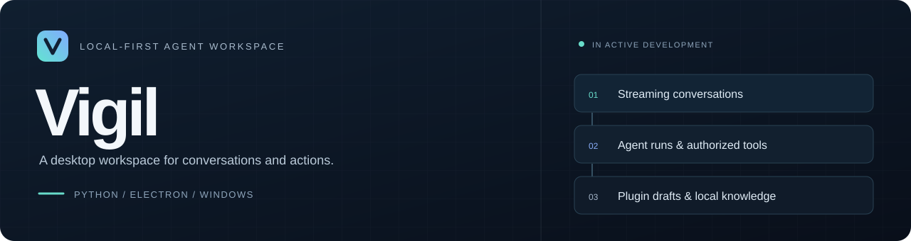
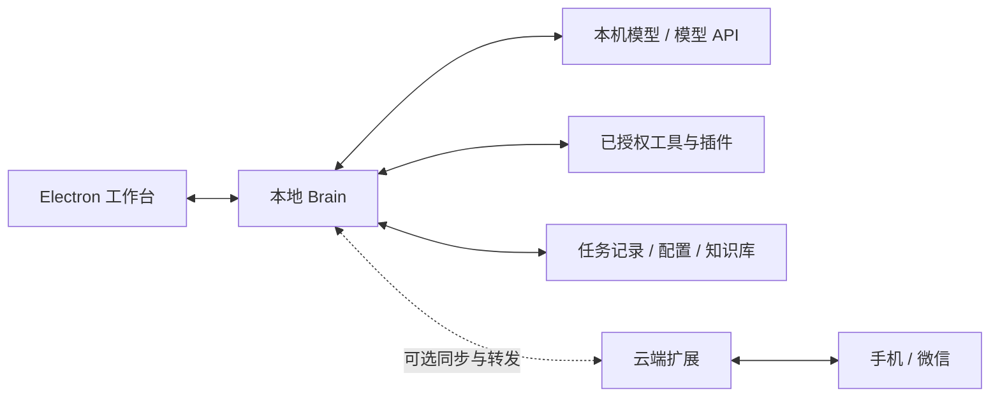

<p align="center">
  
</p>

<p align="center">
  <strong>把对话、工具执行与插件创作，放进同一个桌面工作台。</strong><br>
  本地 Brain · 流式对话 · Agent 任务 · 可选云端扩展
</p>

<p align="center">
  <a href="https://github.com/limingyi2/vigil/releases/latest"><strong>下载 Windows 版</strong></a> ·
  <a href="#开始使用">开始使用</a> ·
  <a href="#开发进度">开发进度</a> ·
  <a href="#文档导航">文档导航</a>
</p>

---

Vigil 是以 Electron 客户端和 Python Brain 为核心的桌面 Agent。你可以在工作台中对话、调用经过授权的工具、管理本地资料，也可以让 Creator 生成并修改插件草稿。

**本地端可以独立运行。** 云端 Brain 用于按需启用的跨设备同步、手机和微信入口；模型连接单独配置，使用远程模型 API 时仍需要网络。离线推理需要另行配置本机模型。

## 开始使用

| Windows 安装版 | Windows 便携版 |
|:---|:---|
| [下载 Vigil Setup 1.0.2](https://github.com/limingyi2/vigil/releases/download/v1.0.2/Vigil.Setup.1.0.2.exe) | [下载 Vigil 1.0.2](https://github.com/limingyi2/vigil/releases/download/v1.0.2/Vigil.1.0.2.exe) |
| 使用安装向导，适合日常使用 | 解压运行所需组件由启动程序处理 |

校验文件与发布说明见 [Releases](https://github.com/limingyi2/vigil/releases/latest)。当前 Windows 包尚未签名。

1. 下载并启动客户端。
2. 在「设置 → 模型与服务商」配置接口地址、模型与自己的密钥。
3. 在工作台开始对话；需要本机工具时，根据界面提示配置授权。
4. 需要跨设备功能时，再配置云端同步及相应入口。

> 插件草稿、安装后的插件和 Agent 任务有各自的状态。生成草稿并不代表已经安装，也不代表插件功能已经通过真实环境验证。

## 能做什么

| 模块 | 已有能力 |
|---|---|
| **流式工作台** | 逐步显示正文、提供者允许展示的思考与执行阶段；记录失败原因并恢复会话展示 |
| **Agent 任务** | 模型与工具多轮执行，记录步骤和结果；支持预算停止、取消及同一 run 内的工具去重 |
| **Creator** | 插件创作与修改、真实流式输出、作业去重、快照、取消和草稿管理 |
| **模型接入** | OpenAI 兼容接口；按服务商、端点、模型适配输出参数与结果类型 |
| **本地资料** | 记忆与约定、知识库导入及检索、按渠道配置人格 |
| **扩展与连接** | Python 插件、目录型插件市场、JS 技能，以及可选的云端同步和手机 / 微信入口 |

### 工作台预览


*界面示意使用测试数据，实际界面随版本更新。*

## 架构



模型负责提出下一步，执行器检查预算、状态和工具参数，再通过现有工具系统派发操作。工具结果返回模型后，可以进入下一轮。

## 开发进度

最新桌面安装包为 **1.0.2**，包含 P1 与 P2 的实现。当前开发源码位于默认 `dev` 分支；发行安装包与开发分支的功能范围分别记录。

| 阶段 | 状态 | 交付 |
|---|---|---|
| P0 · 执行契约 | 已冻结 | 路由、模型能力策略、执行状态、事件与旧接口兼容规则 |
| P1 · 模型与 Creator 流式 | 已实现 | 动态输出参数、结果归一化、Creator 流式作业和会话展示恢复 |
| P2 · Agent 执行循环 | 已实现 | 多轮模型 / 工具循环、持久运行记录、预算、取消与防重放 |
| 后续多步插件完善 | 尚未实施 | 按计划逐步补齐分文件生成、验证与修复等能力 |
| 任务检查点与显式继续 | 开发源码已实现 | Agent Run 支持显式继续、插话与 workflow 检查点；具体边界见对应测试与契约 |

**当前边界：** 预算耗尽不会自动追加预算或继续执行；进程重启后的在途任务标记为中断，不自动重放工具。取消会阻止后续派发，已经开始的外部操作可能仍然完成。工具去重针对同一 run 的调用身份与规范化参数，并不等于外部系统的事务保证。

实现范围、测试记录和未验证项见 [P1 交付记录](https://github.com/limingyi2/vigil/blob/p2-agent-execution/docs/VIGIL_P1_IMPLEMENTATION_REPORT.md) 与 [P2 交付记录](https://github.com/limingyi2/vigil/blob/p2-agent-execution/docs/VIGIL_P2_IMPLEMENTATION_REPORT.md)。

## 从源码运行

环境：Windows、Python 3.12、Node.js / npm。以下命令在 PowerShell 中执行。

```powershell
git clone https://github.com/limingyi2/vigil.git
cd vigil
git checkout dev

py -3.12 -m venv .venv
.\.venv\Scripts\python.exe -m pip install -r brain/requirements.txt
Copy-Item brain/config/config.example.json brain/config/config.json
```

填写本机 `brain/config/config.json` 中的模型设置后，启动 Brain：

```powershell
.\.venv\Scripts\python.exe brain/server.py
```

另开一个终端启动桌面界面：

```powershell
cd vigil/client
npm ci
npm start
```

源码运行、云端部署、插件结构和其他客户端的详细说明保存在 [使用与架构手册](docs/USER_GUIDE.md)。

## 文档导航

| 想了解什么 | 入口 |
|---|---|
| 使用、配置、架构与构建 | [详细手册](docs/USER_GUIDE.md) |
| 统一执行协议与阶段范围 | [执行契约](https://github.com/limingyi2/vigil/blob/p2-agent-execution/docs/VIGIL_AGENT_EXECUTION_STAGE1_CONTRACT.md) |
| Creator 的作业、草稿与流式协议 | [Creator 契约](https://github.com/limingyi2/vigil/blob/p2-agent-execution/docs/VIGIL_CREATOR_STAGE1_CONTRACT.md) |
| 任务恢复的设计与验收约定 | [任务恢复契约](https://github.com/limingyi2/vigil/blob/p2-agent-execution/docs/VIGIL_TASK_RECOVERY_STAGE1.md) |
| 已完成的 P2 功能与限制 | [P2 交付记录](https://github.com/limingyi2/vigil/blob/p2-agent-execution/docs/VIGIL_P2_IMPLEMENTATION_REPORT.md) |
| 评测方法、轨迹和对照数据 | [评测文档](https://github.com/limingyi2/vigil/tree/p2-agent-execution/docs/evaluation) |

## 配置与隐私

仓库只提供示例配置与测试数据。模型密钥、云端口令、真实人设、聊天记录、运行日志和 SSH 私钥应保存在本机受保护的位置。部署脚本通过环境变量获取连接配置。

本次隐私维护已重写部分 Git 历史，**旧克隆不要直接推送或合并回远程，请重新克隆干净仓库**。维护说明见 [PRIVACY_MAINTENANCE.md](PRIVACY_MAINTENANCE.md)。
