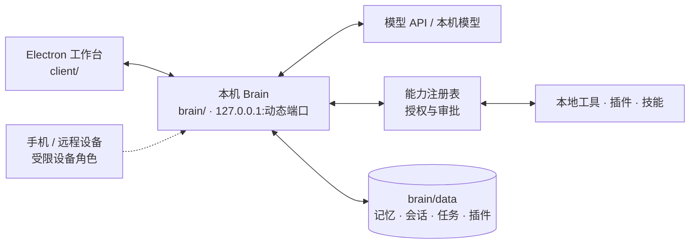

<p align="center">
  
</p>

<p align="center">
  <strong>把对话、工具执行与插件创作，放进同一个桌面工作台。</strong><br>
  本地 Brain · 流式对话 · Agent 任务 · 能力授权
</p>

<p align="center">
  <a href="https://github.com/limingyi2/vigil/releases/download/v1.1.9-p21.7.20261025.1/Kestrel.Setup.1.1.9-p21.7.20261025.1.exe"><strong>下载 Windows 版</strong></a> ·
  <a href="#开始使用">开始使用</a> ·
  <a href="#架构">架构</a> ·
  <a href="#文档导航">文档导航</a>
</p>

---

Vigil 是一个桌面 Agent 工作台：Electron 客户端 + 本机 Python Brain。你可以在这里对话、让它调用经过授权的工具、管理本地资料，也可以让 Creator 生成、修改并安装插件草稿。

**整台机器就是完整系统。** 记忆、人设、会话、插件、任务记录都在这台电脑的 `brain/data/` 里，Brain 是本机进程，只监听本机端口。没有云端大脑参与日常对话，也没有"同步上去才算存住"这回事——联网只在两处发生：调用远程模型 API，以及你主动安装插件时下载包。

> 历史说明：早期版本是"云端权威源 + 本地终端"，P8.1 起改为本地优先，相关同步链路、微信通道和云部署脚本都已退役。代码里仍能看到 `sync_client` / `sync_outbox` 等残留模块，它们不会被启动，详见 [架构说明](docs/ARCHITECTURE.md)。

## 开始使用

| Windows 安装版 | Windows 便携版 |
|:---|:---|
| [下载 Kestrel Setup 1.1.9-p21.7](https://github.com/limingyi2/vigil/releases/download/v1.1.9-p21.7.20261025.1/Kestrel.Setup.1.1.9-p21.7.20261025.1.exe) | [在 Releases 里选便携包](https://github.com/limingyi2/vigil/releases) |
| 使用安装向导，适合日常使用 | 解压后由启动程序处理所需组件 |

安装包文件名形如 `Kestrel.Setup.<版本>.exe`（`Kestrel` 是桌面端的构建名，产品仍叫 Vigil）。版本号、SHA-256 与发布说明以 [Releases](https://github.com/limingyi2/vigil/releases) 里对应那一条为准。当前 Windows 包尚未代码签名，首次运行可能触发 SmartScreen 提示。

1. 下载并启动客户端。
2. 在「设置 → 模型与服务商」填写接口地址、模型名和自己的 API Key。
3. 在工作台开始对话。需要本机操作时，工具会先申请授权，你在卡片上确认后才会执行。
4. 需要装扩展时，把插件或技能仓库链接发给它，或从插件市场里选。

## 能做什么

| 模块 | 已有能力 |
|---|---|
| **流式工作台** | 正文逐字输出；提供者允许时展示思考内容（默认折叠）；工具调用有阶段与进度；失败原因留在会话里可复查 |
| **Agent 任务** | 多轮模型 / 工具循环，记录每一步的调用与结果；支持预算停止、取消、同一 run 内工具去重 |
| **能力与授权** | 统一注册表（`capability_registry`）管住插件、知识库、本地工具等入口；读操作直接给，写操作和外部副作用先出审批卡，一次性令牌只生效一次 |
| **扩展** | 目录型插件市场、按链接安装插件与技能、Python 插件与 JS 技能两套宿主、插件权限声明与装后核验 |
| **Creator** | 插件创作与修改、真实流式作业、快照、取消与草稿管理；草稿不等于已安装 |
| **模型接入** | OpenAI 兼容接口，按服务商 / 端点 / 模型适配参数与结果形态；密钥登记在服务商名下，可多套切换 |
| **本地资料** | 记忆与约定、知识库导入与混合检索、分人设配置 |
| **Codex 桌宠** | 移植自 codex-bailong-desktop-pet 的桌面小助手：直读本机 Codex，桌面查看任务状态、完成提醒、额度与 Token 日报；Agent Center 负责启动与 CLI 引导（见 `pet/README.md`） |

### 工作台预览


*界面示意使用测试数据，实际界面随版本更新。*

## 架构



模型提出下一步，执行器检查预算、状态与工具参数，再经能力注册表派发；结果回到模型进入下一轮。模型永远不会直接拿到工具句柄，也填不了调用方身份——这两件事都由进程内状态决定。

进程与端口、模块分工、事件协议、权限模型、发布流程见 **[架构说明](docs/ARCHITECTURE.md)**；日常运行、日志、备份与密钥轮换见 **[运维手册](docs/OPERATIONS.md)**。

## 开发进度

默认分支 `dev`，当前版本 `1.1.9-p21.7`（版本号在 [`client/version.json`](client/version.json)，`code` 用于客户端判断更新）。

| 阶段 | 状态 | 交付 |
|---|---|---|
| P0 · 执行契约 | 已冻结 | 路由、模型能力策略、执行状态、事件与旧接口兼容规则 |
| P1 · 模型与 Creator 流式 | 已实现 | 动态输出参数、结果归一化、Creator 流式作业与会话展示恢复 |
| P2 · Agent 执行循环 | 已实现 | 多轮模型 / 工具循环、持久运行记录、预算、取消与防重放 |
| P8.1 · 本地优先 | 已实现 | 撤掉云端权威源：同步链路、微信通道、云部署脚本退出运行路径 |
| P19–P21 · 路由与插件分发 | 已实现 | 任务路由契约、插件包隔离、可选插件独立分发 |
| P22 · 按链接安装 | 已实现 | 链接解析 + 分层放行：可信来源直装，其他来源先出审批卡 |
| P23 · 管理上报默认关闭 | 已实现 | 心跳开关改为 fail-closed，去掉 `sync` 配置兜底 |
| 任务检查点与显式继续 | 独立工作线暂停 | 已有设计契约，尚未交付完整 Resume / Recovery |

**当前边界：**

- 预算耗尽不会自动追加预算或续跑；进程重启后，在途任务标记为中断，不自动重放工具。
- 取消会阻止后续派发，但已经开始的外部操作（比如已在执行的命令）可能仍会完成。
- 工具去重只保证同一 run 内相同调用身份与规范化参数不重复派发，不等于外部系统的事务保证。
- 插件安装只校验清单、域名白名单与哈希，**不审计插件代码行为**——装第三方插件等于信任其作者。

各阶段的一次性交付记录已从仓库移除，追溯用 `git log -- docs/`。

## 从源码运行

环境：Windows 10/11、Python 3.12、Node.js 20+。

```powershell
git clone https://github.com/limingyi2/vigil.git
cd vigil

py -3.12 -m venv .venv
.\.venv\Scripts\python.exe -m pip install -r brain/requirements.txt
Copy-Item brain/config/config.example.json brain/config/config.json
```

填好 `brain/config/config.json` 里的模型配置后启动 Brain：

```powershell
.\.venv\Scripts\python.exe brain/server.py
```

另开终端启动界面：

```powershell
cd client
npm ci
npm start
```

测试与发布包构建：

```powershell
.\.venv\Scripts\python.exe -m pytest tests -q
.\scripts\build_client.bat          # Brain + 客户端安装包，要求工作区干净
```

## 文档导航

| 想了解什么 | 入口 |
|---|---|
| 全部现行文档的分类索引 | [文档索引](docs/README.md) |
| 系统怎么组成、数据放哪、权限怎么判 | [架构说明](docs/ARCHITECTURE.md) |
| 日常启动、日志、备份、密钥轮换、下线检查 | [运维手册](docs/OPERATIONS.md) |
| 使用、配置、插件结构、构建细节 | [使用与架构手册](docs/USER_GUIDE.md) |
| 统一执行协议与阶段范围 | [执行契约](docs/VIGIL_AGENT_EXECUTION_STAGE1_CONTRACT.md) |
| Creator 的作业、草稿与流式协议 | [Creator 契约](docs/VIGIL_CREATOR_STAGE1_CONTRACT.md) |
| 任务恢复的设计与验收约定 | [任务恢复契约](docs/VIGIL_TASK_RECOVERY_STAGE1.md) |
| 扩展清单、权限与兼容规则 | [扩展通信契约](docs/P9_extension_protocol.md) |
| 插件市场怎么用 | [插件市场指南](docs/04-插件市场使用指南.md) |
| 评测方法与对照数据 | [评测文档](docs/evaluation) |

## 配置与隐私

仓库只提交示例配置与测试数据。真实的模型密钥、`brain_token`、人设、聊天记录、日志和私钥都留在本机受保护的位置，`brain/config/config.json` 已被 `.gitignore` 排除。

如果你曾经把密钥写进过会被同步或提交的位置，**请直接轮换**，不要指望删除文件就安全了。轮换步骤见 [运维手册 · 密钥与凭据](docs/OPERATIONS.md#密钥与凭据)。

本仓库曾为清理历史中的密钥重写 Git 历史，**旧克隆不要直接推送或合并回远程，请重新克隆**。维护说明见 [PRIVACY_MAINTENANCE.md](PRIVACY_MAINTENANCE.md)，轮换清单见 [TOKEN_ROTATION_CHECKLIST.md](TOKEN_ROTATION_CHECKLIST.md)。
