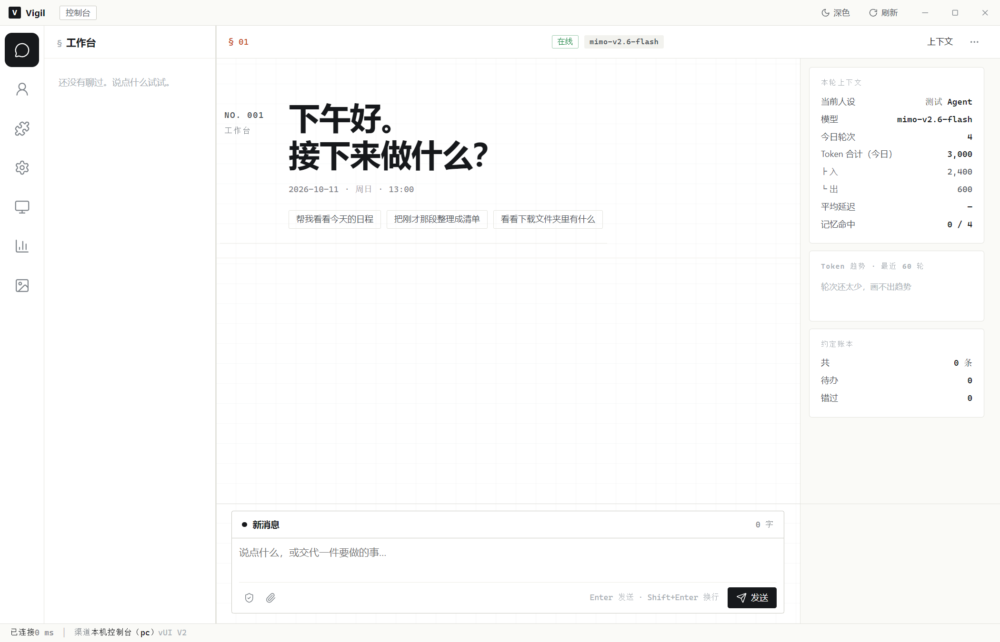
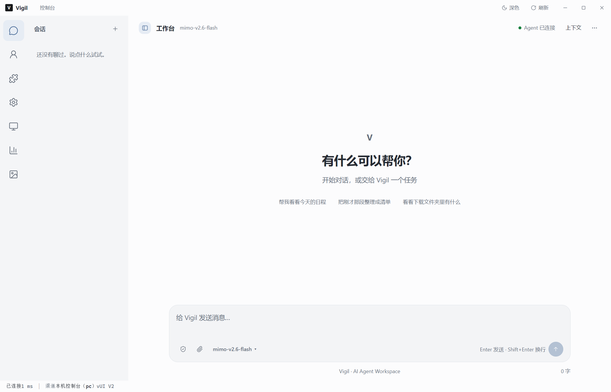
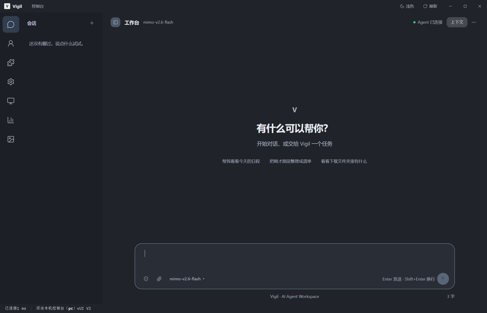
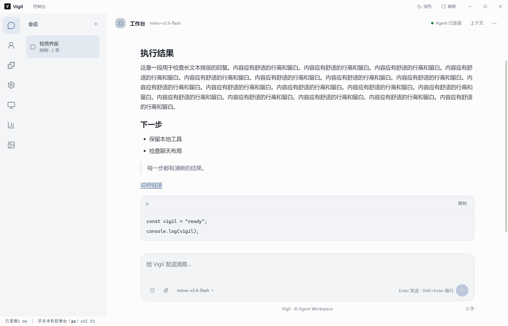
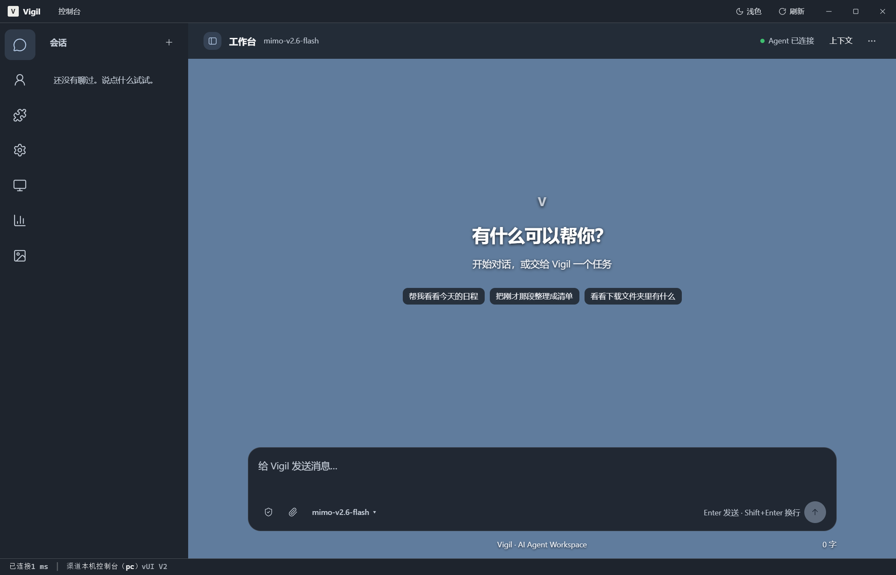

# Vigil UI V2 — 第一阶段改造记录

日期：2026-10-11。分支：`ui/v2-chat-redesign`。独立工作目录：`F:/vigil-ui-v2`。

## 基线与范围

主分支起点为 `5d48e2f`。客户端当时存在尚未提交的修改，因此先在独立工作目录保存客户端现状为 `bc3734c`，再进行聊天视觉重构。审阅本阶段改动应比较 `bc3734c` 与本分支最新提交，而不是直接把整个分支与主分支比较。原工作目录中的未提交修改保留原状。

实际检查包括 `index.html`、`styles.css`、`app.js`、`ui.js`、`pages.js`、`api.js`、`wallpaper.js`、`wallpaper.css`，以及 Electron 主进程、预加载桥与 `wallpaper-host.js`。

聊天 DOM 与绑定集中在 `pages.js`，由 `app.js` 提供导航壳。聊天作用域使用 `body[data-vigil-page="chat"]`，避免与既有导航按钮的 `data-page` 混淆。主题沿用根节点 `data-theme`；壁纸模式沿用 `body.vwp-active`。壁纸经本地 host 提供资源，在页面内 iframe/WebGL 合成，不是独立 BrowserView。材质使用半透明深色作为可读性的基础；输入框的低强度模糊只作辅助，不依赖 Chromium 能否跨 iframe 采样。

本阶段只修改聊天视觉、必要的页面标识与 UI 状态。后端、Agent、模型协议、Electron IPC、认证、安全权限和壁纸播放器的实现均不在本阶段改动范围内。

## 关键差异

| 区域 | 基线 | 改造后 |
| --- | --- | --- |
| 欢迎区 | 大字时段问候、编号和壁纸玻璃卡片 | 居中“有什么可以帮你？”，小品牌标识，低权重快捷提问；首条消息发送后隐藏 |
| 内容宽度 | 气泡以字符宽度限制，输入区使用另一套宽度 | 聊天内容和输入框共用 920px 最大宽度；验证左右边缘偏差为 0px |
| 输入区 | “新消息”卡头、分割线、方形控件 | 20px 圆角、舒适内边距、底部工具栏、右下角圆形发送按钮 |
| 输入行为 | 固定高度，忙碌时禁用 | 自动增高至 180px，低矮窗口上限 120px；空内容禁用、发送反馈、IME 输入保护 |
| 左侧 | 图标导航与不可折叠会话栏 | 保留所有全局入口；232px 会话栏可折叠，窄窗口默认收起并按需覆盖展开 |
| 右侧 | 上下文长期占位，窄窗口直接隐藏 | 默认收起，顶部入口展开；大窗口并排，小窗口按需覆盖显示 |
| 消息 | 方角边框与高密度排版 | 克制的发送方气泡、较宽的回复区、统一行高；Markdown 代码块语言与复制按钮 |
| Wallpaper | 多区域重复模糊、欢迎区实体卡片 | 同一聊天 DOM；欢迎区透明、导航稳定深色、回复阅读材质、只给输入框低强度模糊 |
| 模型入口 | 需通过全局系统导航进入 | 输入框底部直接打开现有模型与服务商页面；没有新增模型切换协议 |

## 文件清单

| 文件 | 主要内容 |
| --- | --- |
| `client/src/index.html` | 引入聊天样式，添加侧栏与发送箭头 SVG，保留原始 CSP 与脚本加载顺序 |
| `client/src/chat.css` | 新增聊天专用 token、浅深色材质、920px 对齐、欢迎区、输入区、消息、代码块与响应式布局 |
| `client/src/styles.css` | 移走旧聊天样式和重复欢迎/输入框覆盖，保留配置页面的原样式及共享控件 |
| `client/src/js/app.js` | 标记当前页面以限定样式范围；提供已有导航回调；聊天顶栏去掉章节编号 |
| `client/src/js/pages.js` | 欢迎 DOM、工具栏模型入口、左右栏状态、会话选中态、自动高度与按钮状态；代码复制事件委托；保留原发送/流式/附件/确认逻辑 |
| `client/src/js/ui.js` | Markdown 新增可选 `codeActions`；仅聊天启用语言标签与复制控件，其他页面默认输出保持原行为 |
| `client/src/plugins/wallpaper.css` | 移除旧欢迎卡片及聊天输入区重复覆盖；以聊天作用域设定不同材质，保留壁纸管理页样式 |
| `client/tools/test-chat-v2-electron.js` | 新增隔离 Electron 回归脚本、真实壁纸 host/iframe 夹具、GPU 信息与截图 |
| `client/docs/ui-v2/README.md` | 本记录、验证边界与待处理事项 |
| `client/docs/ui-v2/results.json` | 本次最终 24 组验证结果、布局测量、GPU 状态及夹具 IPC 记录 |
| `client/docs/ui-v2/screenshots/*.png` | 改造前后截图，全部为合成场景和演示数据 |
| `client/docs/ui-v2/.gitignore` | 仅允许本目录的合成验证截图入库，不改变全局图片排除规则 |

## 实际验证

运行 Windows Electron 28 的真实渲染进程，使用独立临时 `userData`、临时 Steam 目录与本地壁纸 host。Brain 接口及 IPC 由夹具响应。没有调用真实模型、访问真实 Steam 工程、生产配置、凭据库或实际聊天记录。代码复制使用真实剪贴板接口，并在结束时恢复原剪贴板格式与内容。最终夹具关闭临时配置中的失焦/隐藏自动暂停，使首帧验证不依赖窗口是否在前台；生产默认值保留。

最终结果：**24 组检查通过，渲染器错误 0，真实模型调用 0**。原始结果见 [results.json](results.json)。

| 检查 | 结果与边界 |
| --- | --- |
| 普通浅色、普通深色 | 已实际渲染空白欢迎页、历史消息和 Markdown/代码 |
| Wallpaper 模式 | 原播放器加载合成 scene，真实 iframe/WebGL 首帧就绪，欢迎背景透明且没有边框/模糊 |
| 硬件加速 | GPU compositing、WebGL、WebGL2 均 enabled；实际 renderer 为 AMD RX 9070 XT / ANGLE D3D11 |
| 空会话/首条消息 | 欢迎内容在空历史显示，发送立即隐藏；上下文默认折叠 |
| 消息与历史 | 验证流式文本、思考块、完成状态、历史重载和会话定位 |
| 长文本与代码 | 40 条长记录，标题、列表、引用、链接、语言标签与真实剪贴板复制 |
| 输入与快捷键 | 自动增高/上限、空白禁用；实际 Electron 键盘事件确认 Shift+Enter 插入换行；Enter 发送；IME 不误发送 |
| 附件 | FileReader、预览、移除、只附图的发送状态，以及原流式 IPC 的 `text/img/src` 参数 |
| 错误 | 模拟流式错误，错误文字和失败状态显示，按钮恢复正确状态 |
| 左右侧栏 | 折叠/展开；窄窗口会话栏默认隐藏，按需展开；上下文窄窗口可见 |
| 窗口尺寸 | 1400×900、1280×800、900×700、600×650、800×540；没有横向溢出，输入框留在可见范围 |
| 输入与消息对齐 | 920px 最大宽度；左右边缘偏差 0px；消息滚动前后输入区 Y 坐标相同 |
| 模型与安全入口 | 原模型配置表单能进入；原安全控制面板可打开/关闭；未切换生产模型或执行安全操作 |
| 壁纸控制 | 暂停/继续和外观设置保留；导入按钮调用原桥入口，但夹具返回取消，未执行真实文件导入 |
| 非聊天页面 | 模型设置页可渲染；聊天专用宽度变量不泄漏；全局 7 个功能入口保留 |

复验（在客户端依赖已安装的目录中）：

```powershell
Remove-Item Env:ELECTRON_RUN_AS_NODE -ErrorAction SilentlyContinue
./node_modules/.bin/electron.cmd ./tools/test-chat-v2-electron.js
```

工作目录应为 `client`。测试会短暂显示隔离窗口；详细截图输出到忽略的 `client/_shots/ui-v2/`。`--baseline` 仅供本次本地快照对比使用，需要事先准备 `_shots/ui-v2/baseline-src/src`。

JavaScript 语法检查及 `git diff --check` 另行通过。

## 截图

### 改造前



### 改造后普通浅色



### 改造后普通深色



### 浅色消息与代码



### Wallpaper

合成 scene 使用纯色背景，验证的是原 iframe/WebGL 播放器与新聊天布局的合成。



## 未解决问题与潜在风险

1. **没有进行真实模型与生产后端的完整端到端验证**。模型入口已验证，但实际服务商切换、认证、工具执行与权限确认执行结果不在本轮覆盖中。
2. **复杂真实壁纸和持续性能未覆盖**。已验证 GPU 加速及合成 scene 的原播放器；没有对 Steam 大工程、特殊 Web 壁纸或长时间运行进行帧率/显存基准。一次重复验证出现 30 秒首帧超时；夹具关闭临时自动暂停后复跑通过，但没有确认该超时的根因。壁纸插件核心没有变化。
3. **欢迎语遇到极端背景仍有局限**。使用白字和轻微文字阴影，保持无卡片；全白、高亮或密集运动壁纸仍需手动调整已有亮度/遮罩设置。密集阅读区与输入框有独立稳定材质。
4. **既有会话结构**：后端仍是按渠道存储的扁平历史，会话列表是时间分段定位；“新话题”重置上下文并保留记录，不等价于独立后端会话。本次没有改动其语义。
5. **既有消息轮询**：`loadMsgs` 以数量变化判断刷新，没有按忙碌状态隔离重新绘制；实际后端在生成期间改变历史数量，可能影响当前流式气泡。需要单独处理，未在视觉改造中扩大修改。
6. **既有工具步骤节点**：进度回调查找 `#liveSteps`，当前流式气泡模板没有创建此节点；步骤展示链路应单独修复，本次只保留既有回调。
7. **其他管理页面没有全面回归**：仅验证模型设置导航与样式隔离，未宣称人格、记忆、知识库、Agent 管理的全部流程已测试。

## 对比与回退

原客户端仍位于原工作目录。本阶段在独立 Git 分支与目录中完成。查看完整视觉改动：

```powershell
git diff bc3734c ui/v2-chat-redesign -- client
```

需要体验基线时可另建基于 `bc3734c` 的工作目录，或在干净的独立工作目录切换该提交；避免在存在未提交工作的目录执行重置操作。
