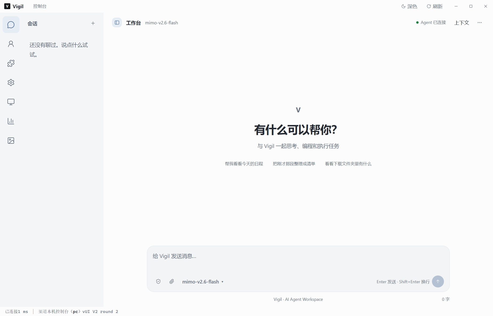
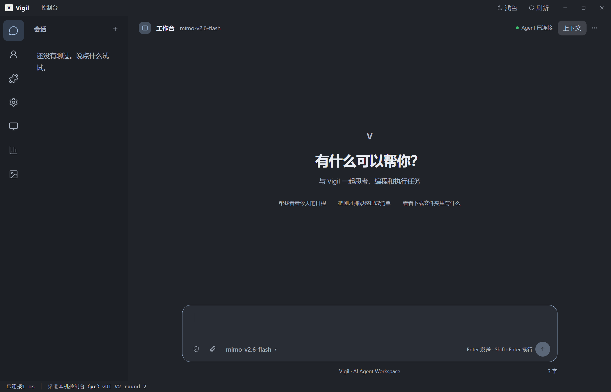
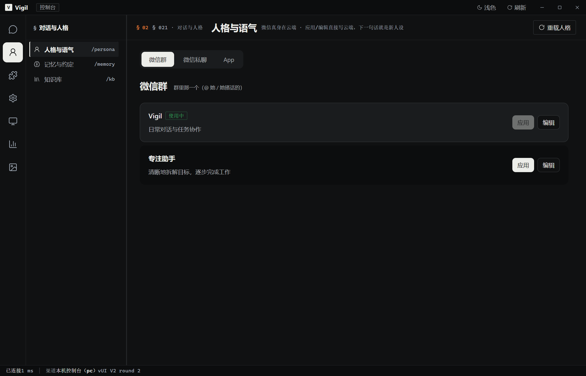
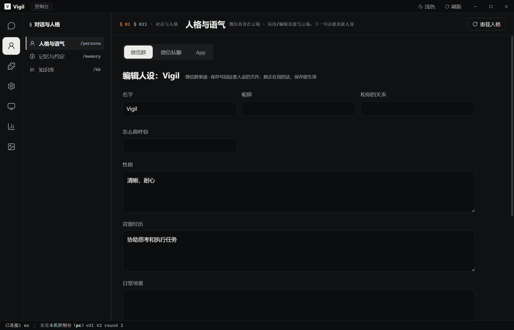
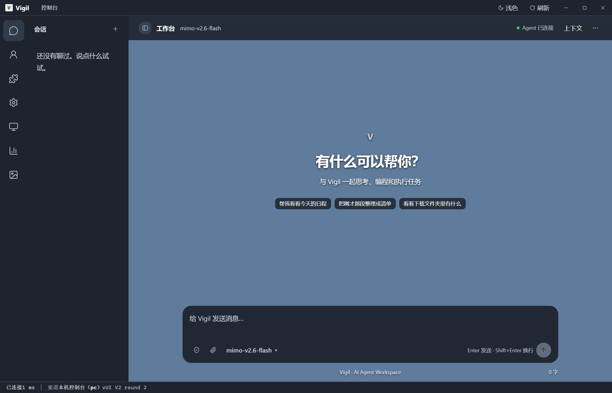
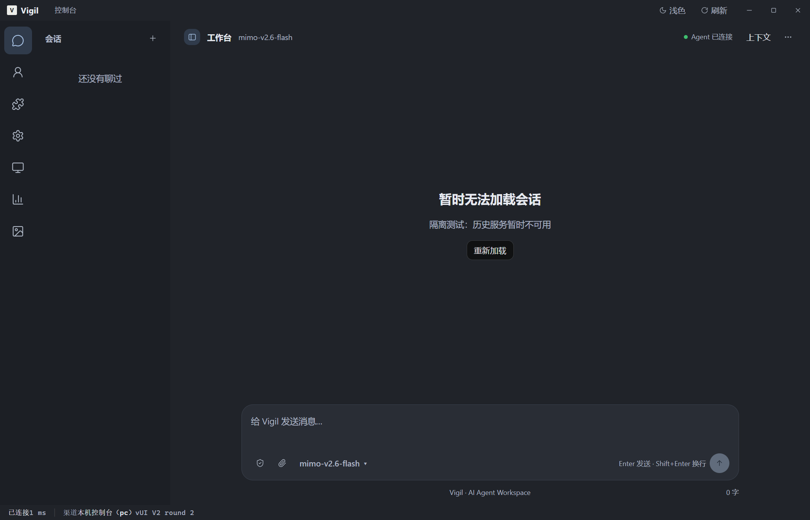

# Vigil UI V2 — 第二轮视觉与回归修正

> 历史资料：本文保留对应阶段的设计、用法或验证记录，部分模块已移除。当前桌面版请查阅 [文档索引](https://github.com/limingyi2/vigil/blob/dev/docs/README.md)，不要直接照本文部署或推断已交付功能。

日期：2026-10-11。分支：`ui/v2-chat-redesign`。工作目录：`F:/vigil-ui-v2`。本轮起点：`6d34472`。

## 检查结论

字号偏小来自固定 CSS 值：原全局正文为 13.5px，聊天正文基础为 14px，多个导航、按钮与辅助标签为 10–13px。源码中未发现全局 zoom、容器 scale 或 Electron setZoom 缩小设置。实际 Electron 计算样式验证：正文 15px、输入文字 15px、按钮与模型选择 14px、欢迎标题 32px；body zoom 为 1、transform 为 none、webContents zoomFactor 为 1。截图像素尺寸受 Windows 显示缩放影响，不能直接当作 CSS 尺寸。

欢迎区在 DOM 中初始为 hidden，只有历史接口成功且 items 为空时才展示。历史读取失败会让欢迎区持续隐藏；此前将浏览器缺少桥接与真实 Electron preload 缺失统一描述为“不在 Electron 里”，也容易误判环境。

正式 Electron 配置使用 `electron/preload.js`，主进程的 API、配置、流式事件与壁纸通道名称和预加载映射一致。此次启动真实 Electron 窗口，直接加载未修改的正式 preload；桥接正常，无 preload-error。未复现此前环境中的加载错误，因此不能断言其具体原因已经查明或修复。

## 修改文件

| 文件 | 修改内容 |
| --- | --- |
| `client/src/styles.css` | 共用字号变量、提高浅深色辅助文字对比度、导航按钮字号、管理页面 1200px 最大宽度和统一内边距、窄窗口顶栏省略辅助面包屑 |
| `client/src/chat.css` | 正文与输入区共用 860px 最大宽度、32px 欢迎标题、14px 模型控件、独立加载与错误区域样式 |
| `client/src/persona.css` | 新增人格子页作用域样式：紧凑条目、渠道分段控件、轻量编辑表单、窄窗口单列与壁纸材质；移除该子页格子背景 |
| `client/src/index.html` | 加载人格样式文件 |
| `client/src/js/pages.js` | 区分加载、空会话、已有历史、错误与重试；发送隐藏欢迎与加载区；历史结果在流式输出期间或节点卸载后不覆盖页面；预览禁止发送；人格样式作用域与真实空状态 |
| `client/src/js/api.js` | 区分 Electron、Electron 缺少 preload、浏览器预览；仅浏览器预览返回明确的空历史占位，其他数据与写入不可用；正式请求协议不变 |
| `client/src/js/app.js` | 明确预览状态文案，捕获异步 boot 拒绝并显示启动错误 |
| `client/tools/test-chat-v2-electron.js` | 替换合成 preload 为正式 preload，主进程服务响应保留隔离夹具；增加字号、窗口 IPC、历史错误、人格、记忆、知识库和环境分类回归 |
| `client/docs/ui-v2/` | 保留第一轮报告，增加本轮结果、失败记录与截图 |

未修改 FastAPI、Agent 执行、模型请求协议、生产 Electron 主进程和 preload、安全配置及 Wallpaper 播放器实现。人格渠道与云端保存行为沿用原实现。

## 实际运行验证

执行环境：Electron 28.3.3、Chromium 120.0.6099.291，Windows，硬件加速沿用 Electron 默认设置。独立临时 userData、壁纸目录、配置和 API 响应，不读取生产历史、凭据或真实项目。正式渲染页面和正式 preload 运行在 `contextIsolation: true`、`sandbox: true`、`nodeIntegration: false` 的窗口中。

最终完整运行退出码为 0，36 组检查通过，正式客户端窗口未记录 renderer/preload 错误。详细结果：[round2-results.json](round2-results.json)。

| 覆盖范围 | 结果及验证边界 |
| --- | --- |
| 普通浅色、深色、空白欢迎 | 实际渲染与截图通过；检查 computed styles 与 860px 宽度 |
| 历史、会话选择、侧栏折叠、上下文折叠 | 隔离历史数据通过既有桥接加载，展开收起与选中态通过 |
| 多行输入、Enter、Shift+Enter、IME | 实际事件检查通过；原发送 payload 保持一致 |
| 流式输出、失败状态、附件、代码复制 | 正式 preload 的流式 IPC + 主进程响应夹具；实际 FileReader 和系统剪贴板检查通过 |
| 模型选择 | 进入既有模型设置表单通过；未调用真实模型 API |
| 人格加载、编辑、保存与空状态 | 数据绑定及 cloud 路由 payload 检查通过；保存只作用于夹具，无生产云端写入 |
| 记忆、知识库 | 隔离条目与文档列表加载通过，切换后人格样式作用域移除 |
| 1280×800、900×700、600×650、800×540 | 聊天无水平溢出，输入区保持窗口内；人格另检查 900×700 和 600×650 |
| Wallpaper | 原 host 和 iframe/WebGL 合成场景实际运行；开启、暂停、恢复、设置入口、关闭和恢复普通布局通过；导入选择使用取消夹具 |
| preload、配置、窗口控制 IPC | 使用正式 preload；配置 get/set、最大化、还原、最小化通道通过；未执行完整生产 main.js 启动链路 |
| 缺少 preload 与浏览器预览 | 另建真实 Electron 无桥接窗口验证错误；再以浏览器 UA 模拟预览验证明确提示与禁止发送，未在独立 Chrome 浏览器运行 |

本轮没有执行真实模型实验，真实模型调用量为 0。JavaScript 语法检查与 Git whitespace 检查通过，但这些检查不等同于上述运行验证。

## 运行中发现的未解决问题

一次扩展回归在壁纸“准备首帧”处等待 30 秒后超时：iframe 已加载，页面可见且聚焦，但统计 running=false、fps=0。保留该次结果：[round2-wallpaper-timeout.json](round2-wallpaper-timeout.json)。相同版本重新完整运行后 36 组通过。首帧偶发失败的原因尚未定位，本轮没有修改壁纸核心，也不能以复跑成功宣称该问题消失。

完整生产 main.js、已安装客户端的启动、真实后端认证与真实模型对话未做端到端验证。壁纸仅测试合成场景，复杂壁纸性能与极端背景下的文字对比度仍需额外验证。浏览器/缺桥环境的 UA 分类只用于展示状态，不作为权限控制。

临时 Electron 缓存存在 Windows 文件锁，部分目录未能清理；它们位于系统临时目录，不包含生产数据。

## 截图

浅色空会话：

深色空会话：

人格列表与编辑：

Wallpaper 空会话（合成场景）：

历史读取失败：

