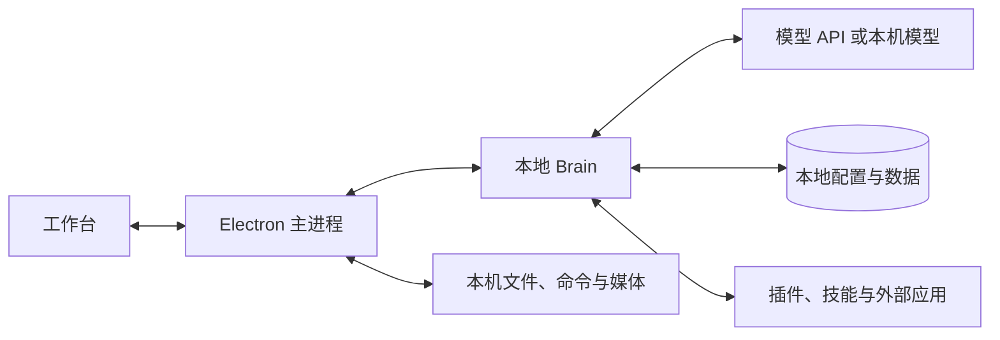

# 架构说明

本文描述 `dev` 分支对应的桌面运行方式。使用说明见 [用户手册](USER_GUIDE.md)，数据维护见 [运维手册](OPERATIONS.md)。旧版云端、手机和微信方案保留在历史资料中，不属于当前安装包的运行路径。

## 进程

| 进程 | 入口 | 职责 |
| --- | --- | --- |
| Electron 主进程 | `client/electron/bootstrap.js`、`main.js` | 窗口、托盘、IPC、凭据、本机工具和更新 |
| 渲染进程 | `client/src/index.html` | 工作台、任务、资料、扩展与设置界面 |
| Brain | `brain/server_launch.py`、`server.py` | HTTP API、上下文、模型请求、任务执行与持久化 |
| JavaScript 技能宿主 | `brain/skill_host/server.js` | 执行已安装的 JS 技能 |
| EgoAgent 服务 | `client/electron/ego-service.js` 管理的外部环境 | 视频分析与问答，按需配置和启动 |

安装版由 `sidecar.js` 启动 Brain，选择动态回环端口，并核对进程与构建身份后报告就绪。源码独立运行时的监听地址和端口由配置或环境决定。

## 模块

| 模块 | 作用 |
| --- | --- |
| `brain/server.py`、`brain/api/request.py` | HTTP 请求与聊天入口 |
| `brain/brain.py`、`brain/model_providers/` | 模型请求、流式工具循环和协议适配 |
| `brain/task_intent.py`、`brain/planner.py` | 任务分类与简单／复杂规划入口 |
| `brain/agent_runs.py`、`brain/coding_harness.py` | 任务步骤、预算、取消、编码执行与验证 |
| `brain/capability_registry.py` | 能力状态、操作权限与审批 |
| `brain/expert_store.py` | 专家目录、推荐、绑定与提示词叠加 |
| `brain/storage/`、`brain/kb/` | SQLite 存储、全文和向量检索、知识库接口 |
| `brain/memory_store_v2.py`、`brain/conversation_context.py` | 长期记忆和对话上下文 |
| `brain/plugin_host.py`、`plugin_manager.py`、`plugin_ops.py` | 插件加载、安装、启停与回滚 |
| `brain/external_apps.py` | MCP、CLI 和指令型 Skill 接入 |
| `brain/paths.py`、`brain/runtime.py` | 路径与共享运行时配置 |

知识库引擎和 Agent 的 knowledge_base 能力在核心中；知识库管理页面使用的 /api/plugin/kb/* 接口依赖已安装的 kb 插件。

`brain/core_features/` 是随核心发布的适配器。可选插件从用户目录 `data/installed_plugins/` 加载；仓库中的 `brain/plugins/` 保留源码与兼容用途，不会因此自动进入安装包。

## 对话与执行

客户端通过主进程向 Brain 发送请求。Brain 结合当前人设、专家、会话历史、检索结果和工具配置构造模型请求。模型返回工具调用时，执行层校验参数和权限，将工具结果回填后继续请求模型。

简单任务直接进入工具循环；复杂任务使用统一任务分类结果决定是否进入规划。Agent Run 另外记录执行步骤、事件、结果与预算。正文、提供者支持的思考内容、工具状态和最终结果通过流式事件返回界面。

普通聊天的只读工具清单与 Agent 执行工具清单分别生成。除 `capability_call` 外还存在独立工具入口，因此权限检查不能只依赖工具名称或提示词。

## 权限

能力注册表区分查询、委派和写操作。需要审批的请求绑定调用身份、会话与目标；审批执行后撤销临时授权，已完成请求的重放返回已存结果。

本机文件和命令由 Electron 的工具执行层继续检查权限模式、路径和命令范围。全部允许模式与默认确认模式的行为不同，不能将“有审批接口”理解为所有操作都必定弹窗。

专家模式可以收窄工具清单，不会增加原本未授予的工具或账户权限。外部应用注册、验证和执行分别返回真实状态；配置存在不代表账户已登录或连接成功。

## 数据位置

安装版将 Brain 数据放在 Electron 用户目录下的 `brain/`。主进程通过 `VIGIL_HOME` 指定该位置。源码版未设置该变量时，默认使用仓库的 `brain/`。

| 相对 Brain 数据根目录的位置 | 内容 |
| --- | --- |
| `config/config.json` | 模型、密钥、开关和专家绑定 |
| `config/personas/`、`config/experts/` | 人设与专家目录包 |
| `data/memory/memory.json` | 当前主记忆库；配置的 `memory_dir` 可改变目录 |
| `data/db/vigil.db` | 会话与任务等主存储，知识库正文、全文索引和向量记录 |
| `data/installed_plugins/` | 已明确安装的可选插件 |
| `data/instruction_skills/` | 已导入的指令型 Skill 及资源 |
| `logs/`、`data/run/` | 日志和进程运行标记 |

长期记忆使用主仓库；聊天历史仍按会话等上下文隔离。旧分区文件可能保留，不能只根据文件名推断当前正在使用的数据库。

默认专家包在首次使用时复制到用户配置目录。升级补充缺少的专家包，不覆盖用户已有专家目录。

## 恢复与限制

任务事件和结果持久化到本地。进程重启后，在途任务标记为中断，不自动重放外部操作。恢复入口、检查点和显式继续的约定见 [任务恢复契约](VIGIL_TASK_RECOVERY_STAGE1.md)。

取消会阻止后续派发；已启动的外部命令是否能中断取决于执行器。工具去重限于定义的 run 和调用身份，不能替代外部系统的事务或幂等机制。

插件安装校验协议、文件清单与哈希，不能据此判断插件代码的全部行为。更改事件协议需要同时验证服务端事件和客户端渲染。

## 构建与发布

`client/version.json`、`package.json` 和 `package-lock.json` 保存一致的版本，整数 `code` 用于更新比较。构建脚本同时生成 Brain 与客户端的构建身份。

正式安装包经版本、来源、大小、SHA-256 和 Windows 安装生命周期检查后发布。产物包括安装程序、blockmap、安装内容清单和更新清单。候选包不会作为正式更新分发。

流程见 [打包与更新](03-客户端/客户端打包与推送更新流程.md)。桌宠及关联 Agent Center 改版在 `zk` 分支，尚未纳入公开安装包。
