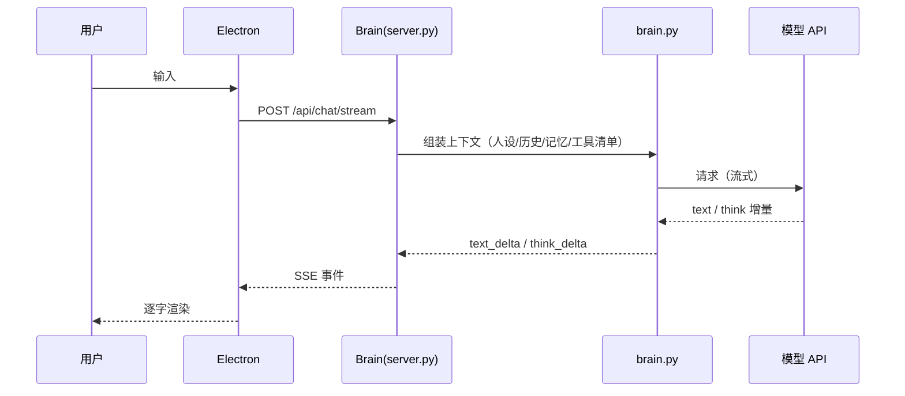

# 架构说明

这份文档回答一个问题：**这套东西现在到底是怎么跑的。** 它只描述当前代码的真实行为，不写规划，也不写历史方案。如果你读到的其他地方与本文冲突，以本文和代码为准——冲突处多半是半迁移留下的旧描述。

配套阅读：[运维手册](OPERATIONS.md)（怎么起、怎么修、怎么轮换密钥）、[使用与架构手册](USER_GUIDE.md)（功能细节、插件结构）。

---

## 1. 一句话定位

**一台机器 = 一个完整系统。** Electron 负责界面，Python Brain 负责一切"会思考、会动手"的部分，数据全部落在本机。没有云端大脑参与日常对话。

这条定位决定了很多设计：

| 因为本地优先，所以 | 具体表现 |
|---|---|
| Brain 是普通子进程，不是远程服务 | 由 `server_launch.py` 选空闲端口启动，端口经 `VIGIL_PORT` 注入，不写死 |
| 数据只在本机 | 记忆、人设、会话、任务、插件都在 `brain/data/`，本机是唯一权威源 |
| 不开端口也能用 | 默认只监听回环；没有 `brain_token` 时**只放行本机**（fail-closed） |
| 联网只在两处 | 调用远程模型 API；安装插件时下载包。其余功能断网可用 |

## 2. 进程与端口

| 进程 | 入口 | 端口 | 说明 |
|---|---|---|---|
| Electron 主进程 | `client/electron/main.js` | — | 窗口、托盘、更新检查、拉起 Brain、注入能力 |
| 渲染层 | `client/src/js/pages.js` | — | 工作台界面，消费 Brain 的流式事件 |
| Brain | `brain/server.py`（打包后 `server_launch.py`） | 动态（回落到 `8788`） | HTTP API + 聊天管线 + 任务循环 |
| 技能宿主 | `brain/skill_host/` | `8790` | 跑 JS 技能，跟 Brain 分开，崩溃不带走聊天 |

Brain 的端口是启动时挑的空闲端口，写进 `VIGIL_PORT` 交给 `server.py`。所以**不要假设 8788 一定被占用**，它是源码直跑时的回落值。

## 3. 代码结构

```
brain/                     Python Brain
  server.py                HTTP 服务、聊天管线、路由（装配层，见 §10 技术债）
  server_launch.py         PyInstaller 入口：种 core_features、起技能宿主、选端口
  brain.py                 模型对话本体（流式产出 text/think）
  agent_runs.py            Agent 任务循环：多轮模型↔工具、事件、预算、取消
  capability_registry.py   能力注册表：操作、权限、审批、一次性令牌
  tools.py                 暴露给模型的工具定义（capability_call 等）
  plugin_host.py           插件加载与宿主边界
  plugin_manager.py        插件生命周期：安装、启用、禁用、重载
  plugin_ops.py            插件事务：下载、校验、落盘、回滚
  creator*.py              插件创作：作业、草稿、快照、安装
  memory_store_v2.py       记忆库（v2）
  persona_store.py         人设
  model_hub.py             服务商与密钥登记、模型切换
  paths.py                 **所有路径的唯一出处**
  runtime.py               共享配置与追踪
  core_features/           随核心发布的能力适配器（插件市场、技能、远程）
  plugins/                 内置插件（wallpaper、kb、reminder…）
  skill_host/              JS 技能宿主
  model_providers/         各服务商的参数与结果适配
client/                    Electron 客户端
  electron/                主进程、preload、sidecar、更新、回滚
  src/                     渲染层（js/css/html）
deploy/brain/              PyInstaller spec（构建入口）
scripts/                   构建、验收、评测脚本
tests/                     Python 测试
market/                    插件市场清单
docs/                      现行文档（索引见 docs/README.md）
```

> 约定：新代码取路径一律 `from paths import ...`，不要自己拼 `os.path.join`。`paths.py` 会区分"冻结运行"（数据落在 exe 旁边）和"源码运行"（落在 `brain/`），并且支持用 `VIGIL_HOME` 把整个家挪走做多实例/测试。

## 4. 一次对话怎么走



关键点：

- **上下文每轮重拼**，不是"记住"了上一轮。所以重要状态必须落到磁盘（记忆、任务记录），不能只存在对话里。
- **思考内容取决于提供者**。支持 reasoning 的模型才有 `think` 事件，事件到达客户端后渲染成默认折叠的块；不支持的模型就是没有。
- **工具阶段不是黑屏**。调用前后模型的叙述会作为 `text` 事件进入正文，工具本身走 `tool` / `stage` / `progress` 事件。

## 5. Agent 任务循环

`agent_runs.py` 负责"模型说一步、执行一步"的循环：

1. 模型返回要调用的工具 → 校验参数（schema 不符直接失败，不会跑一半）。
2. 经能力注册表派发（见 §6），拿回结果。
3. 结果作为工具消息回填，进入下一轮。
4. 满足停止条件（模型不再要工具 / 预算耗尽 / 用户取消）时收尾。

已实现且写进契约的约束：

- **持久 run 记录**：每一步的调用、参数、结果、状态都落盘，重启后可查阅。
- **预算**：耗尽即停，不自动追加。
- **取消**：阻止后续派发；已经在跑的外部操作可能仍会完成。
- **重启语义**：进程重启后，在途 run 标记为中断，**不自动重放工具**。
- **去重**：同一 run 内相同调用身份 + 规范化参数不重复派发；这不是分布式事务。

契约细节见 [执行契约](VIGIL_AGENT_EXECUTION_STAGE1_CONTRACT.md)、[任务恢复契约](VIGIL_TASK_RECOVERY_STAGE1.md)。

## 6. 能力注册表与权限

模型手上**只有一个通用入口**：`capability_call(capability, operation, args)`。所有能力都注册在 `capability_registry.py`：

| 能力 | 操作（示例） |
|---|---|
| `plugins_skills` | `list` `plugin_status` `enable` `disable` `uninstall` `skill_install` `skill_uninstall` `skill_reload` `install_link` `link_preview` |
| `knowledge_base` | `search` `ingest_text` `ingest_path` `reindex` `status` |
| `local_tools` | `specs` `call` `status` |
| `unified_search` | `search` `sync` `reindex` `status` |
| `workspace` / `model_center` / `codex` | 工作区状态、模型状态、任务 |

权限只有三档：

| 级别 | 含义 | 模型体验 |
|---|---|---|
| `read` | 只读查询 | 直接返回 |
| `delegated` | 由模型代为发起，但仍需判断上下文 | 按策略直接执行或转审批 |
| `write` | 有副作用、改变本机状态 | **先出审批卡**，用户点确认才执行 |

审批机制的几个要点（都是踩过坑才有的）：

- **一次性令牌**：批准时生成 `execution_token`，只能兑换一次，且从返回给模型的结果里剔除，模型看不到也填不了。
- **调用方身份由进程内写入**：`current_actor()` 从线程本地读，**模型无法伪造**。依赖"谁发起的"来决定直装还是出卡的逻辑（例如按链接安装）就靠这个。
- **失败要可读**：`operation_purpose()` 要把具体的 capability/operation 带进描述，否则界面上只剩一串一模一样的"调用一个已注册能力"——那等于没有可观测性。

## 7. 扩展模型：插件与技能

两条通道，不要合并：

| | 插件 | 技能 |
|---|---|---|
| 语言 | Python | JavaScript |
| 宿主 | Brain 进程内（`plugin_host`） | 独立进程（`skill_host`，8790） |
| 清单 | `manifest.json`（`schema: vigil.brain-plugin/v1`） | 目录 + 说明 + 脚本 |
| 权限 | 清单里声明 `permissions`，安装时展示 | 由宿主侧约束 |

插件清单的关键字段：`name` `version` `entry` `frontend` `feature` `protocol{major}` `permissions` `files[{path,sha256}]`。

**安装链路**（`plugin_ops` 的事务）：解析来源 → 校验清单与协议大版本 → 域名白名单 / 来源可信判断 → 下载到暂存 → 逐文件哈希核对 → 依赖检查 → 提交落盘 → 安装后重载。失败回滚，不会留下半个插件。

两条入口：

- **市场安装**：只认市场清单 `market.json` 里存在的条目。
- **按链接安装**（P22）：解析 GitHub 仓库 / `tree/<ref>/<插件>` / raw 的 `market.json`，定位到条目。**可信来源直接装，其他来源先出审批卡**，人看过权限再点头。裸 zip 和单文件直链一律拒绝——没有清单就核对不了版本、权限和哈希。

**边界**：安装只保证清单、域名、哈希对得上，**不审计代码行为**。装第三方插件等于信任作者。

## 8. 数据与配置

| 位置 | 内容 | 是否入库 |
|---|---|---|
| `brain/config/config.json` | 主配置：模型、密钥、人设、各项开关 | ❌ `.gitignore` 排除，只提交 `config.example.json` |
| `brain/config/personas/` | 人设模板 | 示例入库，真实人设不入库 |
| `brain/data/memory/` | 记忆库 | ❌ |
| `brain/data/chat_history.jsonl` | 聊天存档 | ❌ |
| `brain/data/installed_plugins/` | 市场安装的插件，独立于安装包 | ❌ |
| `brain/data/db/` `journal/` | 运行记录、任务 run | ❌ |
| `brain/data/devices.json` | 已配对设备与角色 | ❌ |
| `brain/logs/` | `watchdog.log`、`error_server.jsonl` | ❌ |

规矩：**你会手动改的放 `config/`，程序自己写的放 `data/`。**

## 9. 流式事件协议

Brain → 客户端（SSE / 任务事件通道）主要事件：

| 事件 | 含义 |
|---|---|
| `text` | 正文增量 |
| `think` | 思考增量（提供者支持时才有） |
| `stage` | 阶段变化（例如"正在检索"） |
| `progress` | 工具进度摘要 |
| `tool` | 工具调用开始/结束（含参数、结果摘要） |
| `usage` | token / 用量 |
| `image` | 图片结果 |
| `snapshot` | 中间态快照 |
| `done` / `error` | 结束 |

**服务端推了不等于客户端会画。** `think` 事件曾经就是这样丢的：服务端一直在发，`pages.js` 的 `onEvent` 里没有对应分支，收下即丢。改事件协议时必须同时改渲染侧，并且在一轮真实对话里确认它出现了。

## 10. 安全边界

三条原则，历史事故都是违反它们造成的：

1. **默认关闭，不是默认开启。** 管理上报的心跳开关以前写的是 `enabled is False` 才停——配置里 `enabled` 键一旦被清理脚本弄丢，就等于全速上报，而且会回落到旧的 `sync.cloud_url`，每 15 秒带着 Bearer token 往外发。现在改成 `enabled is not True` 就停，并去掉 `sync` 兜底。**判断"是否启用"永远用 `is True`，不要用"不是 False"。**
2. **没配凭据不等于没有凭据。** HTTP 鉴权在没配 `brain_token` 时只放行回环地址，不是全放行。
3. **模型不能自证身份。** 调用方身份、一次性令牌、审批状态都在进程内，工具参数里给不进来。

## 11. 发布与版本

- 版本号在 `client/version.json`：`ver` 是展示用字符串（`1.1.9-p21.5.20261025.1`），`code` 是整数，客户端用它判断有没有新版。`package.json` 和 `package-lock.json` 的 version 必须与之一致，构建脚本会校验。
- `scripts/build_release.py` 负责一次出两件产物：PyInstaller 打包的 Brain（`dist/brain-release/vigil-brain/`，内含 `brain-manifest.json`）和 electron-builder 打出的安装包（`client/dist-release/`，内含 `release-manifest.json`，记 sha256 与 source commit）。
- **正式包要求工作区干净**：`git status --porcelain` 非空就拒绝构建，避免"源码和包里不是同一份东西"。
- 客户端更新只认 GitHub Releases（`client/electron/public-updates.js`）。**发布时必须把 exe 一起上传**——历史上出现过只传了 manifest 和 blockmap 的发布，结果最新版本反而下载不到安装包。

## 12. 已知技术债

排序按"拖累后续改动的程度"，都写清楚现状，不粉饰：

| 问题 | 现状 | 该怎么处理 |
|---|---|---|
| `brain/server.py` 约 5000 行 | 装配、路由、聊天管线、若干历史特例混在一个文件 | 新逻辑落独立模块；逐步把路由组（plugins / creator / agent-center / sync）拆出去，`server.py` 只留装配与转发 |
| 同步链路残留 | `sync_client.py` / `sync_outbox.py` 不会被启动，`record()` 恒为 no-op；配置里 `sync.*` 无人读取 | 保留模块与旧数据（有接口还在读），但**不要**再往这两处加逻辑；真恢复同步要重新设计，不是打开开关 |
| `brain/` 下散落 `_test_*.py` / `test_*.py` | 临时验证脚本堆在模块目录里，容易误以为是被引用的代码 | 有价值的迁进 `tests/`，其余删除 |
| 旧 worktree 与历史副本 | 本机曾有 17 个 worktree 共用同一个 `.git`，分支多是 `codex/*` 实验分支 | 只保留主仓库；实验分支先推远程留档再删目录 |
| 发布不带 exe | 见 §11 | 发布检查项：`release-manifest.json`、`.contents.json`、`.exe` **三件齐** |
