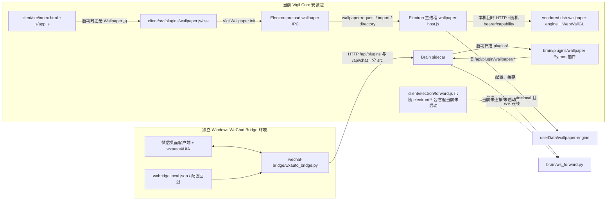
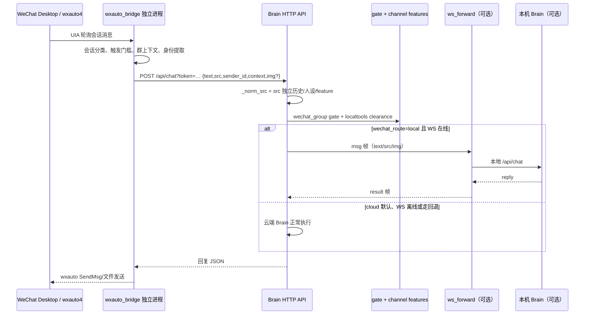

# P9 · Wallpaper 与 WeChat Bridge 拆分前置审计

审计基线：`dev`，提交 `0a1945998f4e41d9efd588c87dcece39e56cd74a`（2026-10-19）。

## 结论摘要

- 当前桌面 Wallpaper 是 Electron 主进程内的本机服务，加上随客户端静态加载的 Renderer UI 和 vendored dsh-wallpaper-engine。它不是当前 Brain 插件市场里的可选插件；启动时无条件初始化宿主，首页无条件调用前端初始化，UI/CSS/vendor 均进入核心安装包。
- `brain/plugins/wallpaper/` 是另一套仍被 Brain 打包、启动时扫描并注册的 Python 插件：配置目录、HTTP 路由、资源和渲染能力均不同。Electron 两处前端注入逻辑都特意跳过同名 `wallpaper`，当前 UI 不消费其接口，但它并非“未被运行”的文件：Brain 仍会加载并提供其路由。外部旧客户端或脚本是否调用这些接口，需要在兼容期继续保留并通过日志/调用方清点确认。
- WeChat 登录、UIA 读写消息在 `wechat-bridge/wxauto_bridge.py` 独立 Python 进程内运行，通过 Brain HTTP `/api/plugins` 和 `/api/chat` 通信。桥接器把 `wechat` 与 `wechat_group` 分开，并让 Brain 做最终渠道隔离和工具权限判断。桌面端已经不启动它。
- `brain/ws_forward.py` 与 `client/electron/forward.js` 是另一个方向的可选双 Brain 通道（云端把微信轮次转给本机 Brain），不是微信登录/收发桥本身。`forward.js` 仍在 Electron 包含范围内，但当前 `main.js` 没有引用或启动它；`ws_forward.py` 仍由 Brain 装载并在路由配置为 local 时参与 `/api/chat`。
- 现有 Brain Python 插件安装器不能安全承载 Electron 原生扩展，也不适合启动和监督 WeChat UIA 进程。当前 Manifest 只是描述元数据，没有能力授权。安装文件事务有回滚，但不能回滚已执行代码/后台副作用；卸载不是文件事务。
- 拆分前必须解决：Wallpaper 两套实现和两份独立设置的迁移；WeChat 部署文档所称的 `brain/wechat_bot/` 源码副本在本仓库实际不存在；`docs/USER_GUIDE.md` 已称桥接拆到独立仓库，而本仓库 P8.2 文档和设置页仍称未来要在此做插件；安装器 Manifest、签名和权限边界不足；Windows 专用微信环境不可能由 Linux fixture 验收替代。

本次只做静态阅读和路径追踪；未读取本机私有微信配置，不运行测试、安装、部署或任何真壁纸/真微信流程，不联系真实 Brain，不发送消息，不调用模型。唯一写入为本审计报告；仓库原业务文件状态干净。

## 当前架构图



## 文件依赖与真实运行链路

### Wallpaper

| 部分 | 实际文件/路径 | 发现 |
|---|---|---|
| UI 入口 | `client/src/index.html`、`client/src/js/app.js`、`client/src/js/pages.js` | HTML 静态引入 `plugins/wallpaper.css/js`；`app.js` 在非设置窗启动时无条件调用 `VigilWallpaper.init()`。Wallpaper 页由该 JS 通过 `VigilPlugin.registerPage()` 注册，导航元数据也写在 `pages.js`。当前没有“安装/启用/禁用”门。 |
| 前端实现 | `client/src/plugins/wallpaper.js`、`client/src/plugins/wallpaper.css` | UI、播放、外观、轮播、暂停、场景 iframe、导入/目录选择都在客户端。图片/视频/WebWallGL/网页场景由该模块直接协调。CSS 不只是扩展皮肤，还影响基础窗口首帧布局。 |
| IPC/API | `client/electron/preload.js`、`client/electron/main.js` | preload 暴露 `wallpaper.request/importFile/directory`；主进程注册 `wallpaper:request/import/directory`。导入走系统文件选择框，目录导入走目录选择框。`request` 的 method 和 resource 在 host 层使用 allowlist 校验；但 IPC handler 本身没有显式检查 `event.sender`、调用方 frame 或功能 enable 状态，拆分时应补 capability/调用方约束。 |
| 宿主与资源 | `client/electron/wallpaper-host.js`、`client/vendor/dsh-wallpaper-engine/**` | `main.js` 启动时创建 host 对象，宿主 HTTP Server 延迟到第一次 API 调用才监听 `127.0.0.1` 随机端口。host 使用每次会话随机 bearer 与随机 capability URL；第三方网页/场景读取端点受 capability/只读路径限制，写接口只由受信主进程 bearer 请求。Scene-live 入口来自 vendored `lib/webwallgl`。 |
| 配置/数据 | Electron `app.getPath('userData')/wallpaper-engine`；vendor 的 `config.json`、upload/cache 路径 | 启动 host 时设置 `DSH_WE_DATA_DIR`。Settings、上传工程、缓存、缩略图/转码等使用 vendor 自己的路径策略；上传目录和缓存目录还能单独配置。Steam Workshop 则是外部用户目录，inventory 会探测 Steam library 或自定义目录。不能随插件卸载而删除这些目录。 |
| 上游内容 | `client/vendor/dsh-wallpaper-engine/UPSTREAM.md`、`package.json`、`lib/**` | 被 Electron `files` 明确打进 `app.asar` 的 vendor 全树。包含比 Vigil 当前使用面更大的上游模块（字体、音频 tap、Now Playing、Mascot 等）；需通过静态依赖树和包体核查确定最小运行子集，不能按文件名删除。 |
| 旧 Python 实现 | `brain/plugins/wallpaper/__init__.py`、`frontend.js/css` | 不同实现：Brain 插件扫描 Wallpaper Engine 并注册 `/api/plugin/wallpaper/we/library|media|preview`、`/config` 路由；配置落到用户 home 下 `.vigil/wallpaper/config.json`。文档代码说明 scene 仅提供静态预览，不是当前客户端 WebGL 实时渲染器。 |
| 打包/测试 | `client/package.json`、`deploy/brain/vigil-brain.spec`、`client/tools/test-wallpaper-*.js` | Electron 的 `files` 打包 `electron/**`、`src/**`、`vendor/dsh-wallpaper-engine/**`，所以即使不使用也包含 `forward.js` 和 Wallpaper vendor；Brain PyInstaller spec 递归收集 `brain/plugins/**`，会包含旧 wallpaper Python 目录插件及前端资源。测试包括 host 安全/导入、Electron fixture 壁纸、独立 v2、真实本机场景测试；后者需本机 Steam/场景，不等于 CI fixture 验收。 |

**真实调用次序：** Electron 窗口加载 `index.html` → `app.js` 启动时初始化 Wallpaper JS → 前端向 Electron preload 请求 inventory/settings → 主进程调用 `wallpaper-host` → 宿主首次启动绑定本机随机端口并挂载 vendor handler → 读取 Steam/自定义目录 → 返回带临时 capability 的媒体链接 → UI 选择素材并加载 image/video 或 WebWallGL iframe。主进程退出时 `before-quit` 关闭 host。当前核心启动和包体已承担 Wallpaper 即使用户不用时也要付的静态成本。

**重复/过时判断：** `brain/plugins/wallpaper` 与 Electron 原生 Wallpaper 在接口、配置、用户数据路径和 scene 渲染上是两套实现；`client/electron/main.js` 和 Renderer 两处均显式排除插件名 `wallpaper`，`test-wallpaper-v2-electron.js` 还验证旧插件 CSS 不执行。这证明当前主 UI 已转向原生宿主，但 Brain 端目录仍会通过 PyInstaller 包装、Brain 插件扫描、路由注册而运行。应先识别已发布安装中旧接口的真实调用方、外部客户端和用户配置，再安排兼容期/迁移；不可只因“旧”注释就删掉。

### WeChat Bridge 与双 Brain 转发



| 部分 | 实际文件/路径 | 发现 |
|---|---|---|
| 登录/收发入口 | `wechat-bridge/wxauto_bridge.py` | 直接控制已登录 Windows 微信 UI，依赖 `wxauto4`、pywin32/UIA、屏幕焦点、微信客户端版本等。用会话名白名单和 `private_chats` 显式分类；未知私聊身份保守按群；群/私聊使用不同 `src` 和 reply mode。群触发可走本机 mention/key words，或送云端 gate；附带按会话缓冲的群上下文、图片和 `sender_id`。 |
| 配置/凭据 | `wechat-bridge/config-example/wxbridge.local.example.json`、`wxauto_bridge.py::load_cfg` | 真实配置期望在桥接机本地 `wxbridge.local.json`；本次没有读取该文件或任何本机凭据。代码还会在指定候选位置回退读取 Brain `config.json` 中的 `brain_token`。Brain HTTP 探活及 `/api/chat` 通过 query token 认证。示例配置含字段说明与占位值，不是 credential vault。微信登录态在桥接运行机器的客户端环境，不应迁入 Vigil Core 配置。 |
| 部署 | `wechat-bridge/vm/{zx.cmd,zx_launcher.py,zx_uia_wake.py,zxrdp.cmd,FIX_AND_RUN.cmd,GO.cmd}`、`vm/vbox/**`、`vm/runtime/**` | VM 安装/配置/日常 runtime 混合在仓库；launcher 唤醒 UIA、检查配置、attach 微信、启动桥接；Tunnel 脚本建 SSH 转发和 self-test。`deploy/wechat/deploy_bridge_m4.py`、`restart_bridge_m4.py` 是运维脚本，包含旧绝对源码路径/机器部署假设，不能直接作为可移植 updater。 |
| Brain API | `brain/server.py`、`brain/paths.py`、`brain/features.py`、`brain/brain.py` | `/api/chat` 用 `_norm_src` 白名单限制 `pc/wechat/wechat_group`，错误 src 归一化；按 src 分开 feature/历史/人设。`wechat_enabled` 为独立总闸；`wechat_route` 可为 cloud/local，默认 cloud。群聊通过 `wechat_group` feature/gate；回复也携带该 src。 |
| 群聊 gate | `wechat-bridge/brain-plugin/gate.py`、部署到远端的 Brain `plugins/gate.py` | 仓库实际 Brain 插件源是 `brain/plugins/gate.py`；桥接目录还有一份渠道专用 gate 源，部署手册指向将其放进远端 Brain。两份实现不是可自动同步的软链接；需做差异/语义比对和部署目标声明。私聊与群聊 source 语义调整过，旧配置 `gate.sources` 是兼容约束。 |
| 双 Brain 转发 | `brain/ws_forward.py`、`client/electron/forward.js`、`brain/server.py` | 服务端 WebSocket `/ws/brain` 接受 master `brain_token` 或 device token；当前 token 可在 query 参数中。`/api/chat` 对两个微信 src 根据 route 把内容交给唯一在线本机客户端并等 ACK/result；本地超时/错误话术和迟到结果另有历史写入逻辑。桌面 `forward.js` 支持 query-token WS、心跳、退避重连和本地请求，但当前客户端 P8.1 起不再 require/start；它仍因 `electron/**` 进入安装包。 |
| 渠道工具权限 | `brain/localtools.py`、`brain/devices.py`、`brain/server.py` | localtools 使用请求级 ContextVar 保存 src/sender，微信远控 feature 默认关闭且失败关闭；开启后私聊要求 `sender_id` 在 owner_ids，群聊即便 owner 也只可用 safe 工具，执行层再次 clearance。设备 token 与 master key 另有权限矩阵。迁移时不能只复制 UI 检查；这些 Brain 端最终门禁必须保留。 |
| 客户端设置页 | `client/src/js/pages.js` | 微信页是只读说明：桥接为外部独立进程；列出本机 API、gate、token、ws_forward 等结构。文案仍称 P8.2 将按当前 Python 插件 UI 安装插件，和独立仓库文档不一致。 |

**源码/运行时副本核验：** 仓库有 `wechat-bridge/wxauto_bridge.py`，没有 `brain/wechat_bot/wxauto_bridge.py`；`wechat-bridge/README.md` 关于“两个路径是同一份代码、部署脚本从 brain/wechat_bot 读取”的说明已不符合当前 checkout。当前示例配置文件存在，源码旁真实 `wxbridge.local.json` 不存在；没有检查 VM/远端运行目录，因此远端部署副本是否和 dev 源码一致仍未验证。`brain/plugins/gate.py` 与 `wechat-bridge/brain-plugin/gate.py` 是两份源码，不应继续用人工复制保持一致。

## 与现有 Brain Python Plugin 的边界

现有 `brain/plugin_host.py` 在 Brain 进程内 `importlib` 加载 Python 文件/目录插件；可挂 tools、prompt/hooks、HTTP ROUTES、`frontend.js/css`。`brain/plugin_ops.py` 的 zip 安装形状只允许描述元数据和 `.py/.json/.md/.txt/.js/.css` 等文件；其 Manifest 字段是 `name/author/version/desc/license/homepage/repository`，明确为描述元数据，不是权限声明。`zxplugin.json` 允许未知键，当前不做权限批准或签名验证。Python 插件和 Brain 核心同进程、同文件系统/配置权限，不是进程沙箱。

Electron 前端插件资源从 `/api/plugins/frontend` 拉取：主进程携带 token 拉 JS 并通过 `executeJavaScript` 注入；Renderer 收 CSS 并以 style 标签注入。preload 暴露的方法属于宽的产品 API，不按插件声明临时授予。虽有上下文隔离和禁用 renderer 任意 `runJS` 的安全收紧，但第三方插件代码仍不应被假定为受权限 Manifest 限制。

安装采用静态 zip 形状校验、不 import 校验、stage/backup、原子替换、registry 和 config 并发保护，失败时恢复被替换的插件文件和 registry。它不回滚插件执行后的网络/文件副作用，也不是崩溃恢复日志。卸载路径直接删除文件、registry 并清 feature/data（data 可显式 purge），不是与 install 同等的备份事务；后台 `start()` 线程需要重启 Brain，插件契约没有统一 stop/dispose。当前市场更不能独立启停/更新 Electron main、IPC 或外部 Python 服务。

所以 Wallpaper 适合未来的 **Electron desktop extension host**（隔离 Renderer + 明确授权的主进程 capability）；WeChat 适合 **独立 channel bridge service**（独立进程、OS/微信 UIA 环境、渠道范围 token、健康检查和升级/回退）。Brain Python gate 若继续作为服务端渠道策略，应按版本作为 Brain 插件组件或核心渠道策略单独交付，不能与微信 UIA 进程混为一体。三者可以共享一份版本化 channel/extension protocol，但执行与权限域不可混装。

## 进入核心安装包的内容

| 构建路径 | 相关步骤 | 当前 Wallpaper/WeChat 结果 |
|---|---|---|
| Electron Builder | `client/package.json` 的 `files: electron/**, src/**, assets/**, vendor/dsh-wallpaper-engine/**` | Wallpaper UI、CSS、host 与完整 vendor 都进入 `app.asar`；`forward.js` 虽未使用但被 `electron/**` glob 包含。WeChat Bridge 源目录不在该 glob 中。 |
| Brain PyInstaller | `deploy/brain/vigil-brain.spec` 对 `brain/plugins/**` 递归拷贝插件源码和附属文件；`scripts/build_release.py` 之后将整个 Brain release 作为 `extraResources` | `brain/plugins/wallpaper/` 的 Python 插件和 JS/CSS 都随 Brain 进入 Core。`wechat-bridge/**` 在 `brain/` 之外，没有被该 spec 收集；当前 VM 安装是单独部署。 |
| source digest/build manifest | `scripts/build_release.py` 将 tracked 源文件纳入源摘要；Electron hooks 校验 Brain manifest 和构建身份 | 被摘要不等于被安装包打包。拆分报告、独立扩展 artifact 和文档提交会影响 build source digest，但不应把 WeChat 源码复制进 Core。 |
| CI | `.github/workflows/windows-package.yml` 的统一 Windows installer job 和单独 `wallpaper_diagnostics` job；`tests.yml` 全仓 Python/Node/compileall | Windows workflow 的 push branches 当前不是 `dev`；Wallpaper 有诊断 job 和 standalone/Electron fixtures，诊断分支绕过打包，部分探针记录为绕过已知 paint assertion 后继续。WeChat UIA/真实微信未有此 workflow 的真机验收步骤。 |

## 必须保留的兼容约束

1. **Wallpaper 用户资产**：保留现有 `userData/wallpaper-engine` 中 vendor config、播放/外观设置、导入素材、upload/custom project 目录、cache/transcode/first-frame 目录和用户自选 Steam 路径；禁止卸载扩展时递归删除这些路径。路径可能被用户迁到数据目录之外。
2. **Wallpaper 外部工程**：Steam Workshop 与自定义目录由用户/Steam 管理；扫描、场景包/图片路径解析、WebGL scene URL、动态资源能力和网页沙箱行为需要保留。旧 Brain `.vigil/wallpaper/config.json` 可能仍存在，需要只读探测和显式映射，不能把它覆盖到 Electron 新配置。
3. **Brain 插件契约**：兼容现有插件 zip（单文件与 `__init__.py` 目录）、可选 `frontend.js/css`、`FEATURE` 渠道开关、重启提示、旧插件 registry/config 和升级期间保留插件数据。现有插件自身不受进程沙箱保护。
4. **WeChat 环境**：Windows 专用 wxauto4/UIA、已登录专用微信桌面实例、窗口焦点/版本差异、VirtualBox VM、自动唤醒/SSH tunnel、部署时配置三要素和没有真实账号时不启动的约束。不可让本机桌面客户端因为装插件而自动登录或开始收发。
5. **渠道语义**：`pc`、`wechat`（私聊）、`wechat_group`（群聊）持久化分区、人设/记忆、gate source、reply mode、`private_chats` 保守默认、`sender_id` owner 校验、群聊 safe-only 和 remote_control 默认关闭。未知 source 归一化、特性配置迁移与 server `wechat_enabled/route` 都需要兼容旧客户端。
6. **既有 HTTP/WS 兼容**：桥接当前对 `/api/plugins` 探活并向 `/api/chat` 传 `src/sender_id/context/img`；老 Brain 忽略后加字段。`/ws/brain` 消息 `msg/ack/result`、25s 超时、心跳、迟到答案历史和 local route 离线/超时回退是现有协议行为。双 Brain 当前默认 cloud；不能把 `forward.js` 看似打包误认为 WS 已启用。
7. **Windows 候选/安装生命周期**：`userData` 安装升级需保持聊天、插件、Brain 配置；扩展版本目录应不可变并保留上一可用版本。Candidate/manifest 源提交与哈希一致；独立更新不得要求重装/覆盖用户数据。

## P9 推荐目标架构

### 目录与安装模型

- Core 保留 `extension-host`、Manifest 验证器、权限 broker、安装事务和空壳 UI 入口；默认安装不包含 Wallpaper engine 资产或 WeChat bridge 二进制/源码。
- Wallpaper 源码拟放 `extensions/desktop/wallpaper/`，包含 `manifest.json`、Renderer UI/CSS、受限 main-process adapter、资源声明、数据迁移和版本化 artifact metadata。运行代码装到 `userData/extensions/<id>/<version>/`，状态仍在 `userData/extension-data/<id>/` 或用户自选目录。单独更新 artifact，不替换 `app.asar`。
- WeChat Bridge 保持独立源仓库/独立 Windows VM 包（`docs/USER_GUIDE.md` 已指向 `zhixia-wechat-bridge`），Vigil 仓库只保留协议 schema、Brain channel adapter/gate 组件和兼容迁移工具。若决定回迁到 monorepo，目标路径另需审核；不要按当前 README 的不存在路径继续部署。Bridge 安装包版本化，在配置明确选择目标端点后才由用户在独立 VM 安装/升级。
- Bridge 的 token 和微信登录态留在桥接运行机 OS credential store/本地 ACL 文件；Core registry 只存 extension id、版本、启用状态、非秘密配置引用和 checksum。一次性用户迁移可将旧 `wxbridge.local.json` 密钥写入安全存储，确认成功后再选择是否清理旧文件；不写 token 到日志、命令行、URL、manifest、聊天历史或 UI。

### Manifest（草案）

```json
{
  "schema": 1,
  "id": "vigil.wallpaper",
  "version": "semver",
  "kind": "desktop-extension",
  "entry": {"renderer": "renderer/index.js", "main": "main/index.js"},
  "min_core": "1.1.7",
  "protocol": "vigil-extension/1",
  "artifacts": [{"platform": "win32-x64", "url": "release asset", "sha256": "..."}],
  "permissions": ["wallpaper.inventory.read", "wallpaper.settings.write", "wallpaper.import.dialog"],
  "data": {"schema": 1, "migration": "migrations/001.js", "preserve_on_uninstall": true},
  "signature": {"key_id": "release-key-id", "algorithm": "ed25519"}
}
```

字段需严格 schema 校验（未知权限拒绝）、artifact hash 和可信签名校验、版本/平台/最小 Core 检查。签名校验只能证明发行来源，不代替 runtime capability。Wallpaper renderer 仅收不可伪造的短生命周期 capability；主进程 broker 对每条 IPC 校验 sender/frame、权限、resource/method 和文件路径。Workshop HTML/WebGL 内容保持独立 sandbox opaque origin/只读媒体 capability，不获得主 preload、Brain API token 或任意文件读写。

WeChat Bridge 单独声明 `kind: "channel-bridge"`、支持的 `channel_ids`、协议版本、Windows/UIA runtime、`capabilities: chat.ingress.private / chat.ingress.group / media.inbound` 与 `secrets: brain_endpoint_ref / bridge_token_ref`。不授予任意 Brain admin API。新增 scoped device credential，仅可写入指定 channel 且具备最小聊天权限；旧 brain_token/query-token 仅在有到期日的兼容窗口通过 server adapter 转换。群/私聊身份由桥接提供并由 Brain 独立重新授权，不能信任 renderer/extension 的 `src` 或 `sender_id` 自报。

### 通信与生命周期

- Desktop host 提供版本化、结构化 IPC/RPC（request id、超时、取消、schema、capability），不暴露原始 Electron `ipcRenderer`。统一 lifecycle：`prepare → verify → stage → migrate(copy/validate) → activate → healthcheck → commit`；失败保留旧版并恢复 registry/alias。disable/uninstall 先停止 lifecycle、撤销 IPC/capability、关闭 server/socket，再保留用户数据；purge 是单独显式、可恢复操作。
- Wallpaper 主进程服务在扩展启用后才懒启动；浏览器资源读取使用 per-session opaque capability，写入只通过 host 方法；需检查扩展 renderer sender，导入仅接受系统选择器返回的文件。版本迁移采用 copy-on-write；回滚切回旧 code 且继续使用旧兼容 adapter，迁移不改写旧数据。
- WeChat 用独立进程协议：Brain → Bridge `POST /v1/channels/wechat/events` 或 WS 事件流；Bridge → Brain 请求含 event id、channel kind、sender handle、dedupe key、附件引用和协议版本。至少一次投递 + idempotency、可观测 ack/retry、过期事件处理、桥接离线状态；不得把微信原始 account identifier 透传给无关扩展。v1 adapter 同时接收现有 `/api/chat`，通过可回滚 feature flag 按用户逐步切换。
- 双 Brain WS 明确作为独立可选 adapter，不藏在 WeChat Bridge 安装包：`cloud → local` 路由保留原 `msg/ack/result` 兼容，未来使用 scoped WS credential/header，支持 heartbeat/reconnect/timeout/late-result。只有用户开启 local route 才连；其退出不影响 cloud route。

## 分阶段实施建议

| 阶段 | 后续精确修改范围（此轮未修改） | 验收与回滚 |
|---|---|---|
| 0 · 封存兼容契约 | 新增 `docs/P9_extension_protocol.md`、Manifest JSON Schema、`docs/P9_data_migration.md`；修正 `wechat-bridge/README.md`、`docs/05-微信/P8.2-微信插件化迁移清单.md`、`client/src/js/pages.js` 的规划冲突；先比对 `brain/plugins/wallpaper/**` 与 Electron Wallpaper UI/配置，`brain/plugins/gate.py` 与 `wechat-bridge/brain-plugin/gate.py`。 | 加静态依赖/接口/权限快照测试；原始配置 fixtures 使用假值；不登录微信。审计基准保留；不动旧目录。回滚仅恢复文档/schema 提交。 |
| 1 · Core 扩展 host | 新增 `client/electron/extension-host.js`、`extension-registry.js`、`extension-broker.js`、`client/src/js/extension-loader.js`、schema/签名验证模块和单元测试；修改 `client/electron/main.js`、`preload.js`、`client/src/index.html`、`client/src/js/app.js`、`client/package.json`、`client/electron/build-contract.js`、`client/tools/build-hooks.js`。暂不移除 Wallpaper/WeChat。 | 扩展未安装/禁用时无子进程、无 listener、无 vendor 加载；IPC sender spoof、权限越界、hash/signature/schema 错误拒绝；install 中断/崩溃恢复，回滚旧 registry。Core 仍可聊天、设置、更新。 |
| 2 · Wallpaper 可选化 | 新建 `extensions/desktop/wallpaper/**` 与发行 manifest/artifact；修改 `client/src/plugins/wallpaper.js/css`、`index.html`、`app.js`、`pages.js` 改为插件页/可选入口；修改 `main.js/preload.js/wallpaper-host.js` 接 broker 并懒启动；修改 `client/package.json` 去除 vendor 默认 glob，改为可选 artifact 下载/安装；修改 `deploy/brain/vigil-brain.spec` 和 `client/tools/test-packaged-brain.py` 仅在兼容阶段控制旧 Python plugin 分发。新增独立 `client/tools/test-extension-wallpaper-*`、迁移测试。 | 用隔离 `userData` 测 Steam fixture、导入图片、目录、视频/网页/scene/WebGL、权限负测；确认配置/上传/cache 迁移前后 hash/内容一致，旧 `.vigil/wallpaper` 不被覆盖；禁用关闭 localhost port/iframe，Core 启动不加载 vendor。先 ship side-by-side adapter 和显式启用；出错时切回随 Core 的旧实现，保留两份状态，不自动清理。真实 Steam/硬件 WebGL 验收单列为 Windows 实机，不以 fixture 代替。 |
| 3 · WeChat Bridge 独立发行与 scoped protocol | Bridge 独立仓库调整 bridge package、`vm/zx_launcher.py`、`vm/runtime/**`、配置 schema/迁移命令和发布 workflow；本仓库修改 `brain/server.py`（新 scoped channel API/auth adapter）、`brain/devices.py`（credential scope）、`brain/localtools.py`（来源验证，不削弱已有矩阵）、`brain/plugins/gate.py`、`brain/ws_forward.py`（显式独立 feature/认证兼容）、`client/src/js/pages.js`（状态/安装链接）和协议测试；废弃/更新 `deploy/wechat/deploy_bridge_m4.py`、`restart_bridge_m4.py` 的硬编码路径前先核对实际使用。 | 首先用假的事件和 credential 验证协议、重放/去重/限流/身份伪造、私聊 owner 与群 safe-only；其次在专用隔离 Windows VM 用专用测试号/测试会话，由人批准后开展登录/收发验收，本次不做。提供 Bridge v1/v2 双协议窗口、每会话 opt-in 和一键回滚到 `/api/chat`，禁用时确认进程退出、SSH 隧道停、凭据原位。真实环境验收记录须另列，不由 fixture 标绿。 |
| 4 · 拆除旧 Core 路径 | 只在旧接口调用方确认归零、至少一个兼容发布周期、设置迁移验证及回滚演练通过后，修改/删除 `brain/plugins/wallpaper/**`、清 `wallpaper-host.js` / vendor 包配置、清未引用 `client/electron/forward.js`；WeChat 方面仅清理已被新 artifact 替代的本仓部署副本/文档，保持 server channel API 和 gate 兼容。修改 build/test manifest 与 docs。 | 从候选安装包独立核验 app.asar/Brain manifest 不含旧 vendor/route/plugin；保留扩展回退 artifact、配置备份和上一 Core installer；一键恢复旧 Core bundle 与目录 alias。没有证据时不进入此阶段。 |

## 历史实现与文档冲突清单（开工前先处理）

1. `brain/plugins/wallpaper` 的旧 API/front-end 配置 schema 与 Electron 原生 Wallpaper schema 不兼容；Brain 包仍携带并加载旧插件；测试夹具仍构造旧路径。必须确定是保留兼容 API、做桥接 adapter，还是明确破坏性移除，并覆盖旧配置迁移。
2. `wechat-bridge/README.md` 称 `brain/wechat_bot/wxauto_bridge.py` 是同一份代码、部署脚本从该处取源；checkout 中并无此文件/目录。README 还称旧部署包摊平为 `bridge\`，部署脚本使用另一历史源码路径。`docs/USER_GUIDE.md` 则称已拆到 `zhixia-wechat-bridge` 独立仓库，须确认当前 authoritative repo、release feed、运行机的更新来源。
3. WeChat bridge-gate 有 `brain/plugins/gate.py` 与 `wechat-bridge/brain-plugin/gate.py` 两个源码；部署文档、渠道默认值、`gate.sources` 的历史调整可能不同步。先做语义 diff 与远端版本核对（不读取/暴露远端账号或凭据）。
4. `client/src/js/pages.js` 微信设置文案和 P8.2 清单仍把 WeChat Bridge 描述为将来沿用 Brain Python Plugin 市场安装；但现有安装器没有桌面 main IPC、外部进程服务、权限 Manifest、密钥槽或 lifecycle stop。必须把“微信桥接本体独立发行”与“Brain gate Python 插件”两个产品交付说清楚。
5. P8.2 迁移清单中的“微信桥接凭据放插件自己的加密配置”没有可见的专属安全存储实现；当前 sample 明确要求手工复制 brain token，代码回退读取 Brain config；协议也把 token 放 query。不能将这段规划文案当已实现安全能力。
6. `docs/USER_GUIDE.md` 旧安全段仍称 `forbidden_wxids` 双层屏障，源码注释记录该名单已移除、以 `expected_wxid` 为主；技术约束、部署手册中历史 wxauto/UIA 版本和启动步骤必须与当前 launcher 一致。
7. `client/electron/forward.js` 无当前 `main.js` 引用，但在 `electron/**` glob 中；它发 query-token WS。`brain/ws_forward.py` 仍被 server 装载且功能被 route local 激活。拆分时需要保留 service-side local routing 兼容，同时决定是否让该 Electron adapter 成为独立扩展，而不是误判成“微信 Bridge 的同一段代码”。
8. `.github/workflows/windows-package.yml` 只对 `master`/特定分支 push；`dev` 不自动触发 Windows packaging。其 Wallpaper diagnostics 分支会跳过正式构建，并在特定 standalone 路径声明绕过无关 paint assertion；报告不能将这些诊断通过等同为候选安装包或真机验收通过。

## 后续验收矩阵

| 维度 | 自动化 | 实际运行验收 | 当前状态 |
|---|---|---|---|
| Core 包瘦身 | 解包 app.asar、Brain manifest/tree 检查；断言没有 Wallpaper vendor/旧 plugin、没有 WeChat bridge；Core smoke/e2e | 在隔离 Windows profile 安装候选、首启、普通聊天、升级/卸载/重启 | 本次只读检查，未运行 |
| Wallpaper 扩展 | Manifest/签名/hash、host IPC、path traversal、sandbox、每种 media fixture、enable/disable/uninstall rollback、迁移 schema | 隔离 profile + 独立 Steam fixture；真机 Steam/不同 GPU 下测 WebGL、网页沙箱和导入文件路径 | 本次未运行；fixture 不算实机 |
| WeChat 协议/权限 | fake event replay/idempotency、scope auth、`src` 伪造、owner/group matrix、gate、停用/断线/超时/迟到结果、token 不落日志 | 独立 Windows VM、人工批准专用测试号、确认 UIA attach、私聊/群聊触发与发送、重启恢复；不调用付费模型 | 本次完全未登录/未发消息，真环境未验收 |
| 更新/回滚 | 分阶段 install failpoint、旧/新 Bridge 协议互通、旧配置迁移幂等、数据保留、断电恢复 | 旧版扩展恢复、Brain 与 Core 独立升级/回退，验证用户目录无丢失 | 本次未运行 |
| CI | Ubuntu Python tests/compileall + Node；Windows 包装/独立扩展 artifact smoke；dev workflow 只在确认后加触发 | 候选 manifest 源提交、hash、包内容和隔离安装报告一致 | 本次只读检查 workflow 和清单 |

## 审计范围边界

不登录真实微信、不访问微信账号标识、不读取真实 Token 或本机私有配置、不发送消息、不调用模型或付费 API、不检查远端 VM/服务器、不构建或安装候选、不修改业务代码。本报告仅基于当前 dev 仓库文件、静态调用方搜索和文档；远端实际 bridge 运行版本、真实微信环境、真实 Steam/GPU/壁纸工程及旧接口外部调用量均未验证。
