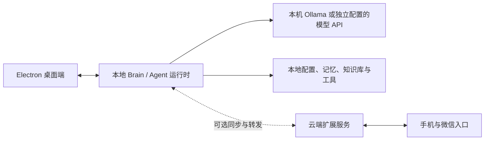

> 详细使用与架构参考。返回 [Vigil 首页](../README.md)。

# Vigil

Vigil 是以桌面端为中心的独立 Agent。Electron 客户端与本地 Brain 组成完整运行端，
负责对话、工具执行、插件和本地数据；不连接云端 Brain 也可以启动和使用。
模型可通过 OpenAI 兼容接口接入本机 Ollama 或远程模型服务。
**云端是可选扩展**，用于跨设备同步、微信 / 手机入口和远程服务。
完全离线对话需要本机模型；断开云端 Brain 与断开模型 API 是两种不同情况。

**人格与项目无关。** 人格是 `brain/config/personas/*.json` 里各自定义的配置，
仓库不预置角色。项目叫 Vigil，人格叫什么是人格自己的事。

技术栈：Python 3.12 · Electron（桌面客户端）· PyQt6（桌宠，旧版）·
Android WebView（手机）· Node（JS 技能宿主）· LLM 走 OpenAI 兼容接口 ·
语音走阿里云百炼

---

## 目录

| 章节 | 内容 |
|---|---|
| [架构总览](#架构总览) | 双大脑怎么分工、谁权威 |
| [装起来跑通](#装起来跑通) | 各端怎么启动 |
| [双大脑与云端同步](#双大脑与云端同步) | 本地优先：改了什么怎么上云、微信怎么路由 |
| [配 API 与模型](#配-api-与模型) | 接哪个服务商、密钥怎么管 |
| [说话多少与搭话](#说话多少与搭话) | 话痨度滑条与 1 档只@ |
| [桌面客户端](#桌面客户端) | Electron 控制台有什么、怎么发版 |
| [写插件](#写插件) | 加一个工具/一个功能 |
| [装技能（JS）](#装技能js) | 另一条通道 |
| [本地知识库](#本地知识库) | 让她翻你自己的文档 |
| [改人设](#改人设) | 人格文件怎么改 |
| [功能开关](#功能开关) | 按渠道开停 |
| [模块表](#模块表) | 每个文件负责什么 |
| [构建 APK](#构建-apk) | 打包手机端 |
| [测试](#测试) | 跑用例 |
| [Agent 评测记录与对照数据](evaluation/README.md) | Planner A/B、Qwen 实战、原始轨迹与复测前后 |
| [最新测试报告](../测试/README.md) | Qwen 六题实战、资源消耗与本地知识库验证 |

---

## 架构总览



运行原则：

1. **桌面端独立运行**。本地 Brain 保存本机配置和数据，提供对话与工具执行。
   Electron 负责交互与本机能力，两者共同构成桌面 Agent。
2. **云端按需连接**。同步与远程渠道入口按现有配置连接；微信由独立 Bridge
   进程接入 Brain。桌面 Core 不等同于 Bridge，也不因安装 Core 自动启用微信。
   现有同步协议仍由云端维护同步版本权威。
3. **模型连接单独配置**。本机 Ollama 可支持离线推理；采用远程模型 API 时，
   生成回答需要相应网络连接。设备凭据与云端同步凭据分别管理。

---

## 装起来跑通

### 云端大脑

```bash
pip install -r brain/requirements.txt
cp brain/config/config.example.json brain/config/config.json   # 填 api_key / token
python brain/server.py                                          # 监听 :8788
```

`brain_token` 没配时接口只接受本机回环。公网要连就得配，配完用
`Authorization: Bearer <token>` 走请求头。

`fastembed` 第一次跑会下载 bge-m3 模型（记忆检索用），需要联网。

### 桌面客户端（Electron）

```bash
cd client && npm install && npm start
```

启动后自动探测大脑：本机隧道 127.0.0.1:18787 → 本机 8788 → 自带的本地大脑
（sidecar，PyInstaller 打包的 `vigil-brain.exe`，客户端会把它当子进程养起来）。
没有云端时它就是一台完整的单机版：本地大脑独立跑，聊天照常。

### 手机端

```bash
python deploy/rebuild_apk.py
```

装好后「我 → 设置」里填服务地址与 token，只需填一次。

### 旧版桌宠（PyQt6）

`pet/` 还在，能连云端跑，维护优先级已让位给 Electron 客户端。

---

## 双大脑与云端同步

本地优先架构（M1–M5）落成后的分工：

| 能力 | 在哪 |
|---|---|
| 本机对话 / 工具 / 配置 / 记忆 | 本地 Brain；可独立运行 |
| 跨设备同步数据 | 可选云端同步；现有协议由云端维护同步版本权威 |
| 微信（私聊/群）谁作答 | 由独立 Bridge 通过 Brain 当前渠道路由配置决定；具体部署状态需按环境核实 |
| 记忆/人设改动怎么上云 | 本地大脑 outbox → `/api/sync/flush`；seq 账本 + 墓碑 + 幂等 upsert |
| 主人鉴权 | 工具按风险三档分级；私聊主人全放、群聊只放 safe 级 |

- **同步凭据是两把钥匙**：客户端的设备 token 连本机大脑；云端路由 / 数据页
  云端视角用的是云端同步凭据（`sync.cloud_url` + `sync.cloud_token`）。
  配置在客户端「设置 → 云端同步」。
- **双 Brain 转发**由 Brain 侧可选的 `ws_forward` 提供；Electron 中的
  `client/electron/forward.js` 当前未由 `main.js` 启动。不可将其等同于独立微信桥接服务。
- **记忆管理**在客户端「人格与人格 → 记忆与约定」：分区浏览、行内改删，
  走 `/api/memory/*`，改动立即进同步账本。

## 配 API 与模型

改的是 `brain/config/config.json`（从 `config.example.json` 复制）。也可以在
客户端「设置 → 模型与服务商」或 App「设置 → 模型」里改，不用重启。

```json
{
  "provider": "siliconflow",
  "api_base": "https://api.siliconflow.cn/v1",
  "api_key": "<你的 key>",
  "api_keys": { "siliconflow": "<这家的 key>" },
  "chat": "deepseek-ai/DeepSeek-V4-Flash",
  "vision": "Qwen/Qwen3-VL-30B-A3B-Instruct"
}
```

- `chat` 对话模型，**必填**；`vision` / `image` / `audio` 留空就是不启用
- **密钥按家各存各的**（`api_keys`）：换服务商时自动换上那一把，切回存过
  密钥的老家不用重填。客户端会在服务商下拉里标（已存密钥），密钥框下面
  会显示当前这把属于哪家
- 服务端预拉模型清单时按 `provider` 参数认领密钥：显式传入 > 这家自己存的 >
  当前那把，三级回落。拿别家的 key 去试拉只会 401，这是"换了服务商模型
  列表不变"的老坑，已钉死（见 `tests/test_model_provider_switch.py`）
- 老配置没有 `provider`/`api_keys` 字段也没关系：启动时按接口地址反推并
  自动登记（`model_hub.adopt_current_key`），幂等

### 加一家服务商

只改 `brain/model_hub.py` 一处：

```python
PROVIDERS = {
    "siliconflow": {"name": "硅基流动", "base": "https://api.siliconflow.cn/v1",
                    "models_doc": "https://docs.siliconflow.cn"},
    "xiaomi":      {"name": "小米 MiMo",  "base": "https://api.xiaomimimo.com/v1",
                    "models_doc": "https://mimo.mi.com/docs"},
    "custom":      {"name": "自定义",     "base": "", "models_doc": ""},
}
```

加完重启，客户端和 App 的服务商列表里自动多一家 —— 前端按服务端返回的
`providers` 渲染，不用改前端代码。选好服务商：接口地址自动带出、模型清单
自动拉；本地部署（Ollama / LM Studio / vllm）选「自定义」手填地址。

模型清单由服务端问服务商的 `/v1/models` 拉，按名字关键字自动分成
对话 / 看图 / 生图 / 语音四栏（视觉版有正则兜底：`glm-<版本号>v` 这种
命名子串匹配钉不住）；拉不到就退回内置清单，界面会标明来源。

> 兜底清单里的模型 id 要照实测写，照文档抄会给出选不上的项。
> "思考默认开启"的模型当看图模型时 `max_tokens` 要给大，不然推理把
> token 吃光、正文为空，看着像"不支持图"。

## 说话多少与搭话

`brain/chatty.py`：话痨度 1–10，按渠道（App / 微信私聊 / 微信群 / 本机）
各存一份，客户端「能力 → 功能开关」里是滑条，App/微信渠道直改云端。

- 2 档以上：搭话判定照旧，判定不过再按 `(档位-1)/9 × 0.45` 的概率救回
- **1 档 = 只@硬闸**（`plugins/gate.py`）：被@、@所有人、叫名字才开口，
  不问模型直接判；名字匹配会兜底人设的 `nicknames` 和 `name`

## 桌面客户端

`client/`，Electron。功能面：

- **工作台**：聊天（流式）、聊天输入框旁的盾牌面板管本地操控授权
- **数据**：云端/本机两个视角切换 —— 微信渠道的账在云端，本机只有
  PC 控制台自己的账，全 0 不是 bug 是口径
- **人格与记忆**：记忆分区管理与知识库导入；当前部分人设编辑/切换接口仍面向云端，断连时存在限制
- **能力与扩展**：功能开关（滑条按渠道）、本地操控（她在你这台电脑上干活，
  全程确认气泡 + 操作日志 + 撤销）、生活面板、Brain Python 插件管理。
  现有 Python 插件机制不是 Electron 桌面扩展安装器，也不提供远程 Bridge 生命周期管理。
- **连接与系统**：本地大脑状态/重启、模型与服务商、云端同步、危险操作
- **Wallpaper Engine**：使用原来的 Brain Python 插件，从「能力与扩展 → 插件市场」安装；插件源不随客户端或 Brain 安装包内置，下载后的插件独立存放在运行时数据目录。
- **常驻**：托盘图标（左键显示/隐藏，右键退出）、推送更新

### 推送更新（桌面客户端自己的一套）

发版四步：

1. 改 `client/version.json` 的 `code` +1（打进 asar，`readLocalCode` 读它）
2. `npx electron-builder --win -c.directories.output=dist_newX`（输出目录每次换新）
3. 上传 Setup exe 到云端 `app/client/VigilSetup.exe`
4. 更新同目录 `client_version.json`（code / ver / notes / sha256 / size）

之后客户端启动 15 秒、每小时各查一次 `/api/client/version`；发现新版弹窗
询问，同意后下载（进度写窗口标题）→ sha256 校验 → 起安装向导覆盖装。
下载走 `/api/client/setup`，256KB 分块流式，不整块吃内存。

## 写插件

Vigil 有三种扩展入口：Python 后端插件、目录型市场插件、Node 侧 JS 技能。
后端运行插件安装在 `brain/plugins/`，可以声明工具、路由、提示词钩子和前端资源。
Brain 插件市场默认从独立 `vigil-plugins` GitHub 仓库的 `market.json` 读取；GitHub Raw 裸连
不可达时自动回退到 jsDelivr 等公开镜像（清单与制品都先过 SHA-256 强校验，镜像不引入信任风险）。
如果在运行目录的
`config/config.json` 中显式配置 `market_repo`，则改用该本地 Git 仓库并通过
fast-forward-only `git pull` 刷新。市场制品先校验 ZIP SHA-256、Manifest、协议、权限与逐文件 SHA-256，再由 Brain 安装器做
静态结构检查和事务提交。市场插件安装到 `brain/data/installed_plugins/`，不会写进跟踪源码的
`brain/plugins/`，也不会被后续 GitHub 源码提交或正式安装包收录。Wallpaper 是普通 Brain
Python 插件，不是 Electron 桌面扩展；具体路径与边界见
[`docs/04-插件市场使用指南.md`](04-插件市场使用指南.md)。

核心内置插件源码放在 `brain/plugins/`；通过市场安装的插件放在独立运行时目录。

最小可用的插件：

```python
# brain/plugins/hello.py
NAME = "hello"
DESC = "打招呼"

def on_turn_in(ctx):
    """每轮聊天前跑一次。返回字符串会拼进系统提示。"""
    return "现在是新的一天，记得主动问好。"

def prompt(ctx, native):
    """往提示词里加内容。native=True 表示主链路在用原生 function calling。"""
    return ""

def on_reply(reply):
    """她回完话之后跑一次。"""
    pass
```

### 四个钩子

| 钩子 | 什么时候跑 | 能做什么 |
|---|---|---|
| `on_turn_in` | 每轮聊天前 | 返回文本拼进系统提示；`ctx.veto(why)` 可以**否决这轮**（不问她） |
| `prompt(ctx, native)` | 组装提示词时 | 追加内容。`native` 区分主链路是原生 FC 还是标签解析 |
| `on_reply` | 她回完话 | 后处理，比如记账、发通知 |
| `start(brain)` | 服务启动时 | 拿 brain 引用，起自己的线程 |

### 加一个工具（让她能调）

光有钩子只能改行为。要让她**主动调用**，得给工具声明 schema：

```python
NAME = "weather"
DESC = "查天气"

TOOL_SPECS = [{
    "name": "weather",
    "description": "查询某个城市的实时天气",
    "parameters": {
        "type": "object",
        "properties": {"city": {"type": "string", "description": "城市名"}},
        "required": ["city"],
    },
}]

def invoke(name, args):
    """真正执行。args 是 dict。返回字符串，或 dict（会被转成 JSON）。"""
    if name != "weather":
        return None
    return fetch_weather(args.get("city"))      # 你的实现
```

🔴 **`TOOL_SPECS` 不能少**。只声明 `TOOLS` + `TOOL_HELP` 走的是标签解析那条
兼容路径；主链路读的是请求里的 `tools` 字段，没有 schema 的工具模型看不见。
症状是"装了、列表里有、开关能点、就是不用" —— 很难查。

### 声明功能开关

```python
FEATURE = "weather"       # 受功能开关和渠道开关管
```

不声明的话它在所有渠道都开着。

### 装 / 卸

面板「插件」页拖个 `.zip` 就能装。zip 里只允许 `.py` / `.json` / `.md` / `.txt`，
且只能有一个 `.py`。

### 哪些 import 会失败

```python
from config import X          # ❌ brain/ 下没有 config.py
from runtime import CFG_PATH  # ✅ 配置路径从这儿拿
from paths import PLUGIN_DATA_DIR   # ✅ 插件自己的持久化目录
```

🔴 这类错**模块能 import、加载器也验得过** —— 错在函数体里的 import 又被
`except Exception` 吞掉，所以插件静默不干活、零日志。写完直接调一次那个函数
把 import 逼出来。

详见 [`docs/插件系统.md`](插件系统.md)。

---

## 装技能（JS）

Python 插件是 import 进大脑进程的。外面能下到的技能包（QQ Agent 等用的那套，
`skill.json` + `index.js`）是 JavaScript，塞进同一个上传口只会装上一个必然
import 失败的假条目，所以另开一条通道：

```
Python 插件  brain/plugins/*.py     → import 进大脑进程
JS 技能      brain/skill_host/      → Node 侧跑，大脑用 HTTP 调
```

模型用两个固定入口，不把每个技能名硬编进工具清单：

- `skill_list` —— 看有什么
- `skill_call` —— 调其中一个

宿主默认只监听 `127.0.0.1:8790`，先起它：

```bash
cd brain/skill_host && node server.js
```

技能包形状是 `包名/index.js` 或 `包名/包名/index.js`。
详见 [`docs/JS技能支持.md`](JS技能支持.md)。

---

## 本地知识库

入口为 `brain/plugins/kb.py`，实现位于 `brain/kb/`；源码运行时，索引与文档块存储在
`brain/data/kb/`，按「人设 × 渠道」分区。打包运行时的数据位于本地 Brain 可执行文件
旁的 `data/kb/`；设置 `VIGIL_HOME` 时按该目录定位。
检索需要启用知识库并通过导入接口建立索引，直接复制文件到索引目录不会自动入库。
嵌入后端可配置为 API、本地 bge-m3 或 fastembed；具体依赖与实际效果取决于所选后端。

```bash
# 导入一个文件或整个目录
curl -X POST http://127.0.0.1:8788/api/plugin/kb/ingest \
  -H "Authorization: Bearer <token>" -H "Content-Type: application/json" \
  -d '{"path": "D:/文档/手册"}'

# 看她能查到什么（门槛设 0，看全貌）
curl "http://127.0.0.1:8788/api/plugin/kb/search?q=怎么配&k=3" \
  -H "Authorization: Bearer <token>"
```

她聊天时每轮自动检索一次并注入命中的段落（门槛 0.45，宁可不给也不塞无关内容），
也可以自己调 `kb_search` 主动去查。嫌每轮多一次 embedding 就把 `inject` 关掉，
只留工具。

接口都在 `/api/plugin/kb/*`，靠插件机制接线，**没改 `server.py`**。
搭建说明见 [`docs/archive/本地知识库.md`](archive/本地知识库.md)，最新验证见
[`测试/本地知识库验证报告.md`](../测试/本地知识库验证报告.md)。

---

## 改人设

人设是 `brain/config/personas/` 下的 json，**仓库不预置角色**，自己写。

```json
{
  "name": "麦麦",
  "nicknames": ["麦麦"],
  "personality": "说话简短，会开玩笑",
  "relation": "女朋友",
  "notes": "这里可以粘一整份人设，会整段拼进系统提示"
}
```

- `name` 她自称什么（也是"叫名字"判定的兜底）
- `nicknames` 群里 @ 她、或者直接叫名字时，靠这个判断是不是在叫她
- `notes` 整份人设正文，粘进去就行

本地 Brain 读取本机的人设配置。当前客户端人设编辑/切换页面仍优先使用云端接口，
断开云端后该页面的编辑能力受限；这项限制不影响本地 Agent 的启动与普通对话。

### 按渠道绑不同人设

`persona_by_src` 指定每个渠道用哪份人设（App / 微信私聊 / 微信群 / 本机可以
各是不同的人）。换人设会换记忆分区：

🔴 记忆、摘要、存档都按 `人设key.渠道` 算。换成另一个 key 就是**一片空白**
——旧记忆还在，只是不会再被检索到。所以换人格前想清楚。

## 功能开关

`brain/features.py`，按「人设 × 渠道」存。客户端和 App 都能点，改完即时生效。

- 全局 `features` 段 = 任何渠道都没覆盖时的初值
- `features_by_src.<渠道>` = 该渠道的覆盖

⚠️ 读写必须同一套规则。历史上读和写不一致过（界面显示已关、运行时其实全开），
最难排查的一类坑。

## 模块表

| 模块 | 作用 |
|---|---|
| `brain/server.py` | HTTP 服务与全部路由：装配大脑、聊天管线、推送更新源 |
| `brain/brain.py` | 决策核心：上下文组装、人设注入、失败兜底 |
| `brain/persona_store.py` | 人设：白名单字段、关系档、身份底线 |
| `brain/memory_store_v2.py` | 长期记忆，bge-m3 向量检索 |
| `brain/recap_store.py` | 历史摘要，日→周→月三层压缩，按人设 × 渠道分区 |
| `brain/agenda.py` | 约定账本：到期提醒，过期标 missed |
| `brain/tools.py` | 工具调用：原生 function calling + 兼容标签解析 |
| `brain/model_hub.py` | 服务商表、密钥按家存、模型清单拉取与分组 |
| `brain/planner.py` | 多步规划：判是否需要规划、逐步执行、结果核对 |
| `brain/chatty.py` | 话痨度（1~10），按渠道各一份 |
| `brain/ws_forward.py` | 微信双大脑路由的 WebSocket 转发（最小 RFC6455 实现） |
| `brain/sync_client.py` / `sync_outbox.py` | 本地 → 云端的记忆/人设同步 |
| `brain/paths.py` | 分区路径：记忆 / 摘要 / 存档按「人设 × 渠道」算 |
| `brain/life_engine.py` | 她的生活推演与日记 |
| `brain/moments.py` | 朋友圈 |
| `brain/voice.py` / `imggen.py` / `selfie.py` | 语音 / 生图 / 自拍 |
| `brain/features.py` | 功能开关，按渠道覆盖 |
| `brain/plugin_host.py` | 插件加载面：扫 `plugins/`、汇总工具 schema、拼提示词 |
| `brain/plugin_ops.py` | 插件管理面：装卸 .zip、元数据、渠道开关 |
| `brain/kb/` | 本地知识库（RAG）：切块、嵌入、检索；`plugins/kb.py` 负责接线 |
| `brain/skill_host/` | JS 技能的 Node 宿主 |
| `client/` | 桌面客户端（Electron）：控制台 + 本地大脑宿主 + 推送更新 |
| `pet/` | Windows 桌宠（PyQt6，旧版入口） |
| `android-app/` | Android 客户端 |
| `admin/` | Web 管理面板（单文件 html） |
| `tests/` | 不联网的回归用例；发版前过 `docs/回归检查表.md` |

## 构建 APK

```bash
python deploy/rebuild_apk.py                     # gradle 全量构建
python deploy/rebuild_apk.py --version 29 --name 5.5   # 顺便升版本号
```

手机端 UI 唯一真源是 `android-app/app/src/main/assets/chat.html`。
构建脚本往里注入 `APP_CODE` 和服务地址，打完还原成空占位 ——
所以仓库里那份看到 `APP_CODE = 0` 是正常的。

## 测试

```bash
pip install -r requirements-dev.txt
python -m unittest discover -s tests -t tests
```

不联网、不读真实配置。CI 在每个 push 上跑这套用例 + 一次全仓 `compileall`。

新增用例当天就靠它抓出过多个真 bug（人设静默回退、插件静默失效、
密钥泄露、面板改了但不生效、模型页密钥错配）。

## 微信接话

WeChat Bridge 是独立渠道服务，发行项目源码仓库为
[`zhixia-wechat-bridge`](https://github.com/limingyi2/zhixia-wechat-bridge)；Vigil 仓库的
`wechat-bridge/` 是有固定来源摘要的归档兼容快照，非 Core 运行依赖。生产部署版本仍需检查桥接机部署记录。
Bridge 与 Brain 内的 Python gate 插件是不同交付物：当前 Brain 权威版本位于 `brain/plugins/gate.py`，
`wechat-bridge/brain-plugin/gate.py` 是不随 Bridge 发行的历史参考，双方通过共享 OPEN/PASS 契约测试而非整文件覆盖同步。
本机微信登录态留在专用桥接运行机。凭据不应进入 Manifest、命令行、日志或聊天历史。
Bridge 仍使用旧 HTTP/WS 接口；WeChat Bridge 的 Core 安装生命周期和新 RPC 尚未实现。P9.1 已实现 Wallpaper 独立桌面扩展的本地安装和启停，但不构成进程沙箱。
P9 拆分方案见 [扩展通信契约](P9_extension_protocol.md) 与 [数据迁移约定](P9_data_migration.md)。

## 文档

| 文档 | 解决什么问题 |
|---|---|
| [`插件系统.md`](插件系统.md) | 加载面与管理面怎么分、渠道开关复用什么、.zip 的形状约定 |
| [`本地知识库.md`](archive/本地知识库.md) | 知识库和记忆为什么是两回事、嵌入三条后端怎么选、门槛为什么是 0.45 |
| [`JS技能支持.md`](JS技能支持.md) | 两条通道为什么不能合并、Node 宿主的契约 |
| [`设计与取舍.md`](设计与取舍.md) | 能力构成、踩过的坑、实测数据 |
| [`客户端详细架构方案-v2.0.md`](客户端详细架构方案-v2.0.md) | 桌面客户端的架构与演进 |
| [`回归检查表.md`](回归检查表.md) | 发版前必过的七节检查 |
| [`微信接入方案.md`](微信接入方案.md) / [`微信群聊接入.md`](微信群聊接入.md) | 微信两端怎么接、坑在哪 |
| [`推理架构方案-ReAct-Plan-思维链.md`](推理架构方案-ReAct-Plan-思维链.md) | 哪些能力能挪到本地、哪些必须留在云端 |
| [`时间感与主动性修复.md`](时间感与主动性修复.md) | 她分不清"刚说的"和"六小时前说的"怎么修的 |
| [`语音平台成本对比.md`](语音平台成本对比.md) | 各家月成本换算 |

## 许可

MIT，见 [LICENSE](../LICENSE)。
