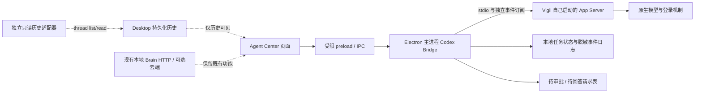

# Vigil Agent Center / Codex 接入 — P0 实测报告

日期：2026-10-11
审查基线：`f5f1359`（本地 `master`）
阶段：协议验证与接入边界确认；尚未实施 Agent Center 业务功能。

## 1. 结论与阶段决策

**受管会话路线可行；已有 Codex Desktop 会话的实时监督路线尚未通过。**

本机 Codex App Server 已实测支持创建独立会话、执行 turn、流式消息、工具事件、审批请求、提问请求、中断与恢复。Vigil 可以据此建设本地 Agent Center，但不能将独立进程读到的桌面历史包装成桌面任务的实时状态。

P0 实验已结束，结果包含 PASS、FAIL 和 UNKNOWN。当前仅建议进入“Vigil 创建并管理 Codex 会话”的实现路线；“监督正在运行的桌面任务”仍需解决原进程连接与事件订阅问题。**本报告不代表完整目标已经实现，也不自动启动 P1。**

两个尤其重要的发现：

- 工具退出码 `7`、工具 item 状态 `failed`，最终 turn 仍为 `completed`。工具失败与任务失败必须分别记录。
- 同一 App Server 的两个已订阅连接都收到了同一个审批请求。接收到请求不等于拥有独占答复权；Vigil 必须自己建立审批归属和一次性处理规则。

## 2. 范围与实际环境

### 2.1 本阶段执行范围

完成本机版本检查、官方资料核对、协议 schema 生成、只读桌面历史探测、受管会话实验、本机确定性协议夹具实验，以及现有 HTTP、WebSocket、IPC、鉴权调用链审查。

所有实验使用临时目录。受管真实测试为独立、临时会话；确定性夹具另用独立 `CODEX_HOME`。未修改生产业务代码，未改登录配置，未批准执行请求，未操作现有桌面任务，未推送仓库。

### 2.2 本机版本

| 项目 | 观察值 | 证据与限制 |
|---|---|---|
| Codex CLI | `0.162.0-alpha.17.2` | `codex --version`，记录了可执行文件 SHA-256 |
| Codex Desktop 包路径版本 | `26.1007.2314.0` | 运行进程所在 WindowsApps 路径；未将它冒充文件 ProductVersion |
| Desktop 子进程 | 存在 `codex.exe app-server` | 只提取了进程身份和安全参数，未导出完整命令行 |
| 实验传输 | stdio；带 capability token 的 loopback WebSocket | 均为本阶段自己启动的 App Server |
| 真实测试模型 | `gpt-6.1-sol`，`low` | 本机默认模型；来自 `model/list` 和 `thread/start` 响应 |
| 真实测试认证 | 已登录的 ChatGPT 账户 | 通过 `account/read` 确认存在；未导出账户身份或凭据 |
| schema | 447 个生成文件，归档 14 个相关文件 | 完整文件哈希清单见证据目录 |

未观察到独立协商的语义协议版本号。实现时应绑定本机 CLI 版本和生成 schema，不能自行编造“协议 vX.Y”兼容承诺。

参考：[OpenAI App Server 官方文档](https://learn.chatgpt.com/docs/app-server)、方案指定的 [openai/codex App Server README](https://github.com/openai/codex/blob/main/codex-rs/app-server/README.md)。字段和实验行为以本机版本的生成 schema 与真实响应为准。

## 3. PASS / FAIL / UNKNOWN 清单

PASS 表示对应限定实验通过；FAIL 表示本次路径未满足要求；UNKNOWN 表示没有足够实验依据。代码存在不等于运行验证通过。

| 检查项 | 结果 | 证据 / 限定条件 |
|---|---|---|
| CLI 启动与 schema 生成 | PASS | 447 个 JSON schema 文件 |
| initialize 握手 | PASS | 初始化前请求被拒绝，错误 `-32600 Not initialized`；初始化后正常 |
| 客户端请求 schema 校验 | PASS | 探针对 `ClientRequest` 校验后发送；未声称所有服务端完整 payload 均经过 schema 校验 |
| 本机模型与认证状态读取 | PASS | 默认模型、账户存在性；未导出凭据 |
| 桌面会话历史发现 | PASS | 当前工作区找到 2 条持久化记录，含当前桌面会话 |
| 桌面历史读取 | PASS | `thread/read includeTurns=true` 得到 34 个持久化 turn；正文未导出 |
| 独立 stdio 进程实时监督已有桌面任务 | FAIL | 桌面快照为 `active`；独立进程返回 `notLoaded`，loaded 列表为空，3 秒观察无任务通知 |
| 默认 daemon control socket 连接 | FAIL | `daemon version` 返回 Windows `os error 10050`；未修改或重启 daemon |
| 连接 Desktop 原 App Server 的其他入口 | UNKNOWN | 未找到并验证可用入口；未尝试接管原进程 |
| 对 Desktop 原任务的 interrupt / approval | UNKNOWN | 未执行；历史可读不能证明具有控制权 |
| 受管独立会话与真实 turn | PASS | 2 个真实 turn，独立临时 workspace，ephemeral thread |
| 流式消息与工具输出事件 | PASS | `item/agentMessage/delta`、`item/commandExecution/outputDelta` |
| 正常 turn 完成 | PASS | 第一次真实 turn 为 `completed` |
| 工具失败与整体失败区分 | PASS | 工具 exit `7`、item `failed`，turn `completed` |
| 真正的 turn 失败事件 | PASS（夹具） | 本机 Responses 夹具返回 HTTP 400，原生 `turn/completed failed` |
| 真实命令审批请求 | PASS | `item/commandExecution/requestApproval`，thread/turn 绑定一致 |
| 等待审批状态 | PASS（夹具） | `activeFlags=[waitingOnApproval]`；两个连接均收到 |
| 中断与待请求清理 | PASS | `interrupted`，出现 `serverRequest/resolved`，未执行审批中的命令 |
| 恢复持久化受管会话 | PASS（夹具） | 独立测试 home，关闭进程后恢复同一 thread，loaded 列表命中 |
| 阻塞式提问 | PASS（夹具） | `item/tool/requestUserInput`、`isBlocking=true`、1 个问题；随后中断 |
| 真实模型自主选择提问工具 | UNKNOWN | 夹具强制返回工具调用，不代表真实模型自然触发能力 |
| 同进程多连接订阅与审批投递 | PASS（夹具） | owner 与 observer 均收到审批请求和 turn 事件 |
| 错连接答复、重复答复、过期答复的拒绝 | UNKNOWN | 未发送审批答案；不能据投递结果声称 App Server 有此防护 |
| capability token WebSocket 鉴权 | PASS（夹具） | 正确 token 建连；错误 token 在握手阶段被拒绝，HTTP 401 |
| Vigil 鉴权纯函数 | PASS（隔离 AST） | 7/7；不是完整 HTTP、设备注册或 IPC 端到端验证 |
| 完整 Vigil Agent Center UI / IPC / HTTP | UNKNOWN | 尚未实现和启动该功能；本阶段不是 UI 验收 |

## 4. 可复查的实验

### 4.1 只读桌面探测

独立 App Server 使用现有 Codex home，仅执行 initialize、account/read、model/list、thread/list、thread/read、thread/loaded/list 等读取。

`thread/list` 限定工作区并设置 `useStateDbOnly=true`。实际发现记录的 `source` 是 `vscode`，因此未来不能只过滤 `appServer` 来源。`thread/read includeTurns=false` 的 turn 数为零是请求选择，不是历史丢失；显式 `includeTurns=true` 才读到 34 个持久化 turn。

`historyMode=paginated` 的响应在这个版本中仍允许上述完整读取成功，不能根据其他版本文档假设其必然失败。

官方说明 `thread/read` 不订阅实时事件，`thread/resume` 会加载并订阅。对已有桌面会话，本阶段没有调用 resume，以免改变其运行行为。因此 FAIL 结论限定为**独立进程的 list/read 方案**，不是断言所有 Desktop 实时接入方式都不可能。

### 4.2 两个真实 turn

共同配置：临时 workspace、`runtimeWorkspaceRoots` 指向该目录、`read-only`、`on-request`、`approvalsReviewer=user`、`ephemeral=true`、禁用网络沙箱访问。线程级覆盖禁用了继承的 1 个 MCP server 与 12 个插件，关闭 Web Search、Apps 与实验分析上报；未写登录或生产配置。

| 场景 | 操作 | 结果 | 耗时 |
|---|---|---|---:|
| tool_and_completion | 读取临时 marker，并执行预期 exit 7 的无害命令 | 一次工具执行；工具 failed，turn completed；流式文本与工具输出可见 | 12.554 秒 |
| approval_observation | 请求为无害打印命令取得沙箱外执行审批 | 原生审批请求到达；立即中断，未答复、未执行 | 4.796 秒 |

每 turn 90 秒观察熔断、工具活动上限 4。探针在观察到超限后调用 interrupt，这不是执行器在第五次调用前必然拦截的硬配额。本轮实际没有触及工具熔断。

真实调用量：2 次 `turn/start`，3 条 `thread/tokenUsage/updated.last` 记录。它们是 3 次完成用量记录的证据，不是网络层 HTTP 请求或重试数量审计。

| 用量 | 数值 |
|---|---:|
| input tokens | 41,375 |
| cached input tokens | 32,640 |
| output tokens | 192 |
| total tokens | 41,567 |

cached input 是 input 的子集。统计使用每条 `last`，没有累加累计 `total`。账户实际费用未核算。

临时 fixture 文件内容未变；workspace 中仍只有 `probe.txt`。真实测试沿用原生登录 home，启动 App Server 可能产生正常运行缓存或日志；没有建立“生产 home 全部文件零写入”的证据。read-only 限制也不等于只准读取一个目录，不能把工作目录或提示词当成完整文件读隔离。

### 4.3 本机协议夹具

夹具模型服务只绑定 `127.0.0.1`，要求临时 Bearer token；独立 `CODEX_HOME` 不含生产登录和会话。App Server 仍是真实 CLI，模型响应为确定性输入。总计 4 次本机模型端点请求，**0 次真实模型调用**。

验证内容：

1. HTTP 400 → 原生 error 与 `turn/completed failed`。
2. 关闭独立 stdio 进程后，在同一测试 home 恢复持久化 thread，历史和 loaded 状态一致。
3. Plan collaboration 模式下强制返回提问调用 → 阻塞式 `item/tool/requestUserInput`；随后 interrupt，不回答问题。
4. 带 capability token 的独立 WebSocket App Server；两个受控连接订阅同一测试 thread；审批请求同时到达两个连接；owner interrupt 后 turn 为 interrupted，命令未执行。

补充失败记录：首次尝试在刚创建、尚未执行任何 turn 的 thread 上从第二个连接 resume，返回 `no rollout found`。先执行一个确定性失败 turn 形成 rollout 后再 resume 才成功。会话恢复流程应处理“新建但尚无持久化 rollout”的状态，不应将它当成永久损坏。

夹具没有验证真实模型的提问策略；其顶层工具目录检测为 false，强制返回仍触发原生提问。归档保留该值，不能宣传成工具发现或自然调用验证通过。

### 4.4 复查命令

```powershell
Get-Command codex
codex --version
codex app-server --help
codex app-server generate-json-schema --experimental --out <临时目录>/schema
codex app-server daemon version
```

实验启动命令为 `codex app-server --listen stdio://`；受控 WebSocket 使用 `--listen ws://127.0.0.1:<临时端口> --ws-auth capability-token --ws-token-file <临时文件>`。没有开放无鉴权远程端口。

复查脚本和执行步骤见 [证据说明](agent-center-codex-p0-evidence/README.md)。真实脚本另需明确传入 `--allow-real-model`；复查默认只执行本机夹具。

## 5. 本机协议字段与状态映射

### 5.1 与实现有关的 schema 事实

| 接口 / 类型 | 本机字段要求 | 实施注意点 |
|---|---|---|
| initialize | clientInfo；可声明 experimentalApi | 每连接各自初始化，不使用别人的 request ID 空间 |
| thread/start | sandbox 为 `read-only` / `workspace-write` / `danger-full-access` | 请求枚举与响应 `readOnly` 对象不同，不直接互抄 |
| thread/start | approvalPolicy、approvalsReviewer、cwd、runtimeWorkspaceRoots、ephemeral | 实测受管配置由响应再次确认 |
| turn/start | threadId、input | 任务级配置与线程级配置分别校验 |
| thread/resume | threadId；支持配置与权限字段 | 只对明确归属的受管会话使用；Desktop 原会话不自动 resume |
| 命令审批参数 | 必须有 itemId、startedAtMs、threadId、turnId | 服务端 JSON-RPC request ID 另行绑定 connection generation |
| 命令审批响应 | 必须有 decision | 接受的 decision 以本机 schema 为准，不发未经审核的答案 |
| 提问参数 | 必须有 isBlocking、itemId、questions、threadId、turnId | 不根据旧文档只实现 autoResolutionMs；保留非阻塞语义 |
| 提问响应 | answers | 与执行审批分开建模 |

### 5.2 建议的界面状态模型（尚未实现）

| 原始观察 | 建议 UI 状态 | 约束 |
|---|---|---|
| turn started / in progress | 执行中 | 必须来自拥有该 thread 的实时连接 |
| active + waitingOnApproval | 等待审批 | 保存原生请求；不要另起 turn 或用聊天文字代替批准 |
| 阻塞式 requestUserInput | 等待回答 | 独立问题队列；不作为危险命令审批 |
| completed | 已完成 | 同时显示失败工具数；不承诺任务内容质量 |
| failed / systemError | 失败 | 展示结构化错误，允许有界恢复 |
| interrupted | 已中断 | 不映射为成功；撤销未答复请求 |
| idle | 空闲 | 线程状态与最后一个 turn 结论分别展示 |
| notLoaded | 历史记录 | 不猜测其在另一个进程中是否正在运行 |
| 连接丢失 | 连接未知 | 不是完成事件；重新订阅后再对账 |

## 6. Vigil 现有代码调用链与复用范围

**当前后端是 `http.server.ThreadingHTTPServer`，不是 FastAPI。** 接入不能按方案中的框架名称臆造 router 或 WebSocket 依赖。

| 位置 / 关键入口 | 当前机制 | 可复用范围与缺口 |
|---|---|---|
| [`brain/server.py:1049`](../brain/server.py#L1049) `start_remote_api`；2830 | 标准库 HTTP server、既有路由分发 | 若将来需要本地 Agent Center HTTP，可沿用处理器与鉴权；不引入第二套框架 |
| [`brain/server.py:290`](../brain/server.py#L290) `_auth_ok` | 配置 token 的 Bearer / 兼容 query；无 token 仅 loopback | 复用身份验证；它不证明 Codex thread 或 approval 所有权 |
| [`brain/server.py:1063`](../brain/server.py#L1063) `_check`、1099 `_is_admin`、1112 `_deny_if_limited_device` | master 或设备 token；设备角色；受限设备默认拒绝 | 新的控制端点必须显式管理员闸门加会话归属，不能只靠路由名称 |
| [`brain/server.py:206`](../brain/server.py#L206) `_device_path_allowed` | GET / POST 允许矩阵 | 新 `/api/agent-center/approval` 对受限设备默认拒绝，隔离纯函数测试通过；实际路由尚不存在 |
| [`brain/server.py:1126`](../brain/server.py#L1126) `_cors` | `Access-Control-Allow-Origin: *` | 不是权限机制；未来审批还需可信调用来源，不能靠 CORS 通行判断授权 |
| [`brain/ws_forward.py:273`](../brain/ws_forward.py#L273) `try_upgrade` | `/ws/brain`；接受 master 或注册设备 token；聊天转发 | 可以参考连接生命周期；不能直接复用为具有审批权的任务总线 |
| [`client/electron/main.js:335`](../client/electron/main.js#L335) `request`；388 `requestStream` | 主进程附加 token、HTTP 请求与 SSE 解码 | 未来 HTTP 读取 / SSE 事件可参考；现有聊天 payload 不改成 Codex 协议 |
| [`client/electron/main.js:885`](../client/electron/main.js#L885) `api` | 仅允许既有 Brain 目标 / cloud 别名，优先 sidecar 动态端口 | 保留目标限制；不给渲染层开放任意地址并附加凭据 |
| [`client/electron/main.js:924`](../client/electron/main.js#L924) `api:stream` | 把 SSE 事件发回调用窗口 | 可参考事件推送；Agent Center 应有独立订阅、任务 ID 与解绑，不占用聊天流 |
| [`client/electron/main.js:642`](../client/electron/main.js#L642) `askLocal`；659 `local:answer` | 全局单个 `asking` 槽；只按 id 匹配答复 | 不能直接承载并发 Codex 审批；缺连接、任务、turn、item、senderFrame 绑定 |
| [`client/electron/main.js:457`](../client/electron/main.js#L457) BrowserWindow 配置 | nodeIntegration=false、contextIsolation=true、sandbox=true | 保留这些边界；不为接入 CLI 而放开 Node 集成 |
| [`client/electron/preload.js:17`](../client/electron/preload.js#L17) contextBridge | 显式 API / stream / local 方法 | 沿用白名单封装方式；不能暴露原始 ipcRenderer、CLI 或凭据 |
| [`client/electron/sidecar.js:155`](../client/electron/sidecar.js#L155) `spawnBrain` | 隐藏子进程、受控 cwd、stdout / stderr、退出与重启 | 参考进程管理方式；Codex bridge 要独立实例与限次重启，不重写 Brain sidecar |
| [`client/src/js/app.js:198`](../client/src/js/app.js#L198) `VigilPlugin.registerPage` | 动态页面注册和导航重建 | 可保留入口扩展；不是进程监督或安全沙箱 |
| [`client/src/js/pages.js:2642`](../client/src/js/pages.js#L2642) Agent 列表 | 通过 cloud 目标读 `/api/management/agents` | 这是节点上报列表，不是本地 Codex thread 列表 |
| [`brain/management.py:113`](../brain/management.py#L113) `_clean_agents`、131 `heartbeat`、193 | 清洗和汇总节点 heartbeat 中的 agents | 数据展示逻辑可借鉴，不能充当本地执行状态真源 |
| [`brain/management_agent.py:65`](../brain/management_agent.py#L65) heartbeat payload | `agents: []` | 当前没有由该模块提供真实 Codex 任务监督 |

鉴权验证采用 AST 抽取纯函数和常量，避免 import 后端触发生产副作用。7 项覆盖无 token loopback / 远端、正确 / 错误 / 缺失 Bearer、设备新控制路径默认拒绝、历史 GET 保留。没有据此声称 HTTP 请求链、设备角色存储或 Electron sender 校验已完成端到端验证。

## 7. 最小接入建议（设计，尚未实现）



P1 优先由 Electron 主进程持有 Codex App Server 子进程及原生连接，页面通过窄 IPC 接口调用；直接复用现有进程管理、preload、导航与事件推送方式。现有 Brain 继续承担其原功能，云端不是本地 Codex 运行的前提。

如后续需要其他设备读取 Agent Center，再增加既有本地 HTTP 处理器的受限接口；审批和任务控制仍汇聚到唯一 bridge。不要让 Electron、Python 和多个浏览器各自维护一套执行或审批状态。

最低新增模块职责：

1. **Codex Bridge**：版本 / schema 检查、隐藏启动、initialize、读写 JSONL、限次重连、事件去重、待请求清理。CLI stdout 是协议通道，stderr 单独脱敏记录。
2. **任务登记表**：taskId、workspace、threadId、turnId、connection generation、来源与权限。只控制登记的受管 thread。
3. **待请求表**：原生 request ID、thread、turn、item、连接代次、到达时间、类型、状态、截止时间。一次性状态转换，禁止重启后补发旧答案。
4. **页面与受限 IPC**：list/read/start/interrupt、审批答复、问题答复、订阅 / 解绑；逐个核验调用窗口与 frame。渲染层不持有登录凭据，不取得原始命令执行能力。
5. **独立历史模式**：明确标为只读；不显示伪实时状态，不提供无归属的批准或中断按钮。

### 审批与提问约束

原生 `requestId` 只在连接上下文中有效，不是全局身份。命令审批还必须匹配 task/thread/turn/item 和当前 connection generation，并来自可信窗口。两个订阅连接收到同一请求时，登记表只建立一条待办；处理后立即同步撤销其他展示副本。

连接关闭、turn 完成或中断、`serverRequest/resolved`、实例重启都必须使待办失效。权限不明、归属不明或处理超时采取关闭 / 中断路径；不得自动接受。提问答案和命令批准分别存储、分别校验。

上述是 Vigil 必须补充的执行级机制，**不是现有实现，也不是本阶段已经验证的安全保证**。本阶段未测错连接、过期或重复答复被原生服务拒绝，因此不能依赖此类假定。

### 工作目录与配置

为新任务创建受控 workspace，并在 bridge 层校验规范化路径与文件变更边界。工作目录本身不限制任意 shell 读写；可写根、网络权限、沙箱 / 执行策略必须实际配置，并以专门负向实验验收。

不要复制生产 `auth.json` 到测试目录。原生登录复用与独立 home 登录是两种配置方案，需显式选择；不能假装共享登录 home 等同于完整数据隔离。生产会话不得被自动 resume 或配置覆盖。

## 8. 后续优先级与验收门槛

| 优先级 | 事项 | 进入下一步的可验证条件 |
|---|---|---|
| P0 | 原生连接和审批归属 | 本报告已指出多连接投递；实现前确认只做受管会话还是另解 Desktop 实时接入 |
| P0 | Runtime 权限边界 | 非登记 thread、越界 workspace、错误连接 / frame、失效 request 都必须由执行路径拒绝 |
| P1 | 受管任务最小页面 | 创建 1 个独立任务，实时显示事件、等待与结束；不依赖云端 |
| P1 | 审批与提问队列 | 并发两项待办互不覆盖；答复只送回原连接；中断后待办撤销 |
| P1 | 状态与日志 | 工具失败和 turn 失败分开；断连显示未知；日志不含凭据或私人正文 |
| P1 | 恢复与停止 | 只恢复受管记录；无 rollout 可解释；退出清理自己启动的进程 |
| P2 | Desktop 历史展示 | 来源明确、只读、分页 / 增量读取；不得宣传为实时监督 |
| 待验证 | Desktop 原进程实时入口 | 必须获得真实连接、订阅和控制归属证据后再开放其控制按钮 |

Planner、委派路由、模型请求业务协议、Wallpaper、人格、记忆、知识库未列入本阶段修改范围。

## 9. 证据索引与未解决项

- [environment.json](agent-center-codex-p0-evidence/environment.json)：版本、源代码哈希、统计、原 daemon 探测结果。
- [discover.json](agent-center-codex-p0-evidence/discover.json)：桌面历史只读探测。
- [managed.json](agent-center-codex-p0-evidence/managed.json)：两次真实 turn 与原生用量。
- [fixture.json](agent-center-codex-p0-evidence/fixture.json)：失败、恢复、提问夹具结果。
- [ws-fixture.json](agent-center-codex-p0-evidence/ws-fixture.json)：本机鉴权、多连接审批投递。
- [vigil-auth.json](agent-center-codex-p0-evidence/vigil-auth.json)：7/7 隔离纯函数检查。
- [schema-manifest.json](agent-center-codex-p0-evidence/schema-manifest.json)：447 个生成 schema 的哈希；[schema/](agent-center-codex-p0-evidence/schema/) 保存相关子集。
- 各 `*-events.jsonl`：经过字段白名单与 ID 别名化的协议轨迹，不是完整原始会话。

剩余未知：Desktop 原进程连接、错连接答复的原生拒绝行为、真实模型自然提问、完整 Agent Center UI / HTTP / IPC、安全负向用例、应用打包后的运行兼容性。

**本阶段停止点：报告与脱敏实验材料已交付，未开始 P1。**
