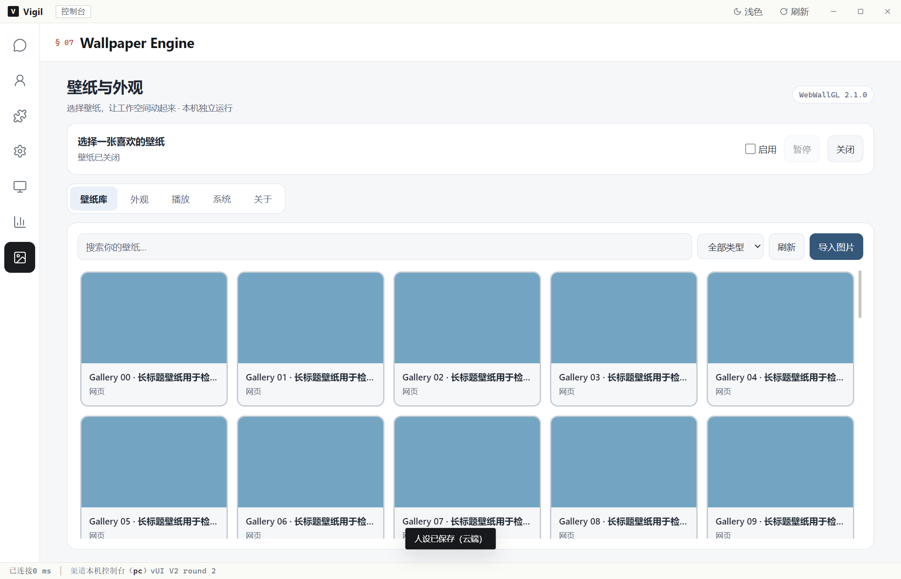
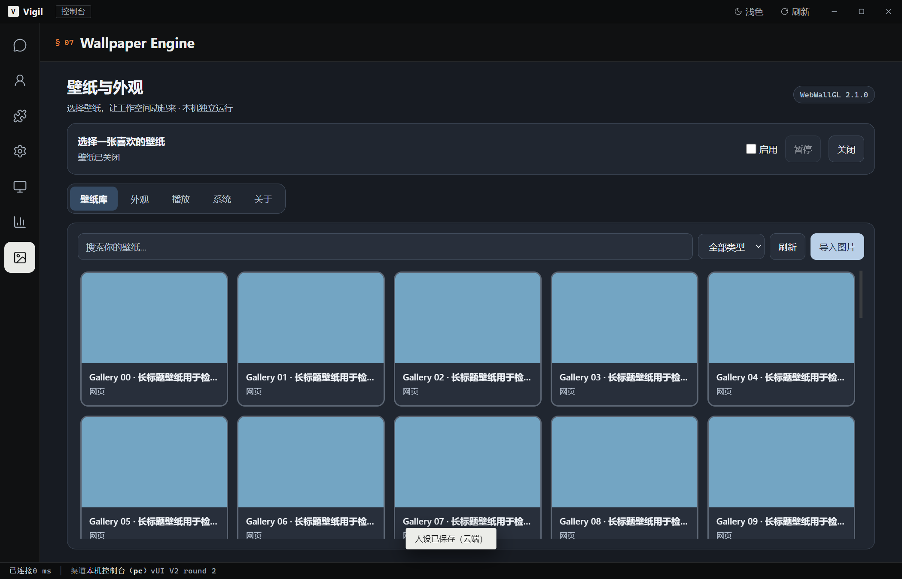
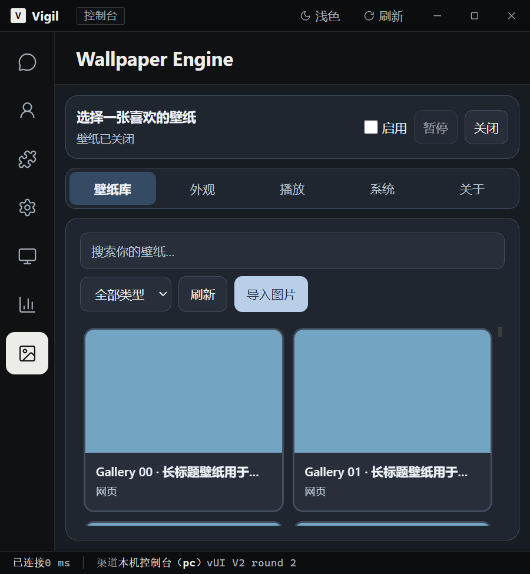

# Wallpaper 界面适配回归报告

日期：2026-10-11。范围：Electron 客户端的 Wallpaper 设置页及相关页面切换。

## 修正内容

| 改造前 | 改造后 |
|---|---|
| 浅色模式沿用深色面板，文字与背景缺少对比度 | 设置页使用独立配色变量，分别适配浅色、深色和壁纸开启状态 |
| 左侧空列表栏占用约 240px | 仅在 Wallpaper 页面隐藏空列表栏和拖动分隔条，保留全局图标导航 |
| 壁纸库随内容增长，整页滚动 | 标题、播放控制、标签和搜索保持可见，仅壁纸库滚动 |
| 名称 12px、类型 10px | 名称 14px、类型 12px，长名称省略并可通过悬停读取完整标题 |
| 多个设置面板重复背景模糊 | 设置面板使用稳定背景材质，取消重复 backdrop-filter |
| 后台轮播可重新渲染共享页面容器 | 仅当当前路由是 Wallpaper 时重绘设置页，聊天页面保持完整 |
| iframe 还未加载便发送控制消息 | 等待当前 iframe 加载后再发送控制与指针消息，保留目标来源检查 |
| 测试程序输出管道关闭时弹出 EPIPE 错误 | 测试脚本处理断开的输出管道，其他类型的错误仍抛出 |

## 实际验证

运行命令（工作目录 `client`）：

```powershell
node --check src/plugins/wallpaper.js
node --check tools/test-chat-v2-electron.js
& ./node_modules/.bin/electron.cmd tools/test-chat-v2-electron.js
```

- 实际运行 Electron 28.3.3 / Chromium 120.0.6099.291。
- 47 项检查通过；0 项失败；0 条渲染错误。
- 硬件加速保持开启，WebGL 使用 AMD Radeon RX 9070 XT / Direct3D 11。
- 使用正式 preload、contextBridge 和 IPC 通道，保持 sandbox 和 contextIsolation 开启、Node.js 集成关闭。
- 49 个临时壁纸工程用于检查长列表，其中一个场景通过实际 Wallpaper 宿主与 WebWallGL 加载首帧。
- 设置页覆盖 1920×1080、1280×800、800×540、600×650；900×420 覆盖极短窗口的外层滚动降级。
- 覆盖浅色、深色、壁纸开启与关闭、搜索、类型过滤、五个设置标签、刷新、取消导入与取消目录选择、暂停与恢复、后台轮播后页面保持。
- 同时回归聊天发送、流式状态、模型入口、Markdown 与代码复制、附件、多行输入、历史、左右侧栏、人格、记忆和知识库界面。
- 模型调用为 0。聊天、人格与知识库数据均为隔离响应，未运行真实 Agent 能力评测。

结果文件：[Electron 回归指标](原始数据/20261011-wallpaper-ui/results.json)。

## 截图

以下截图来自真实 Electron 窗口，预览图使用临时纯色图片，不代表实际壁纸素材质量。

### 浅色模式



### 深色模式



### 窄窗口



## 验证边界

本次未修改 Wallpaper 宿主、上游 WebWallGL 渲染器、FastAPI 或 Agent 核心。使用临时会话、配置与 Steam 目录；未读取生产历史或凭据。尚未遍历真实壁纸库的全部素材，也未开展长时间 GPU 压力测试。已安装的 0.1.8 程序未替换，本报告对应源码运行结果。
